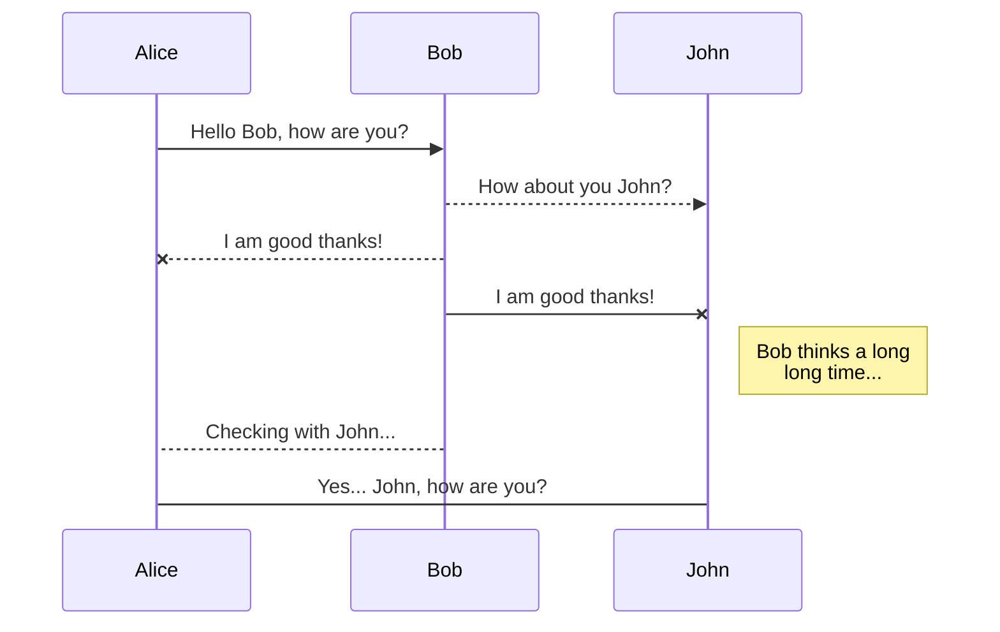
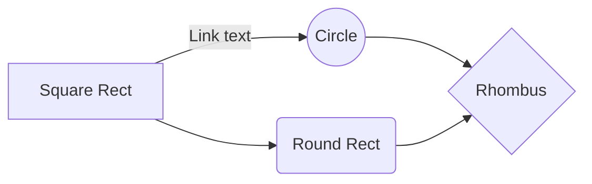

# Hugo 마크다운 및 HTML 서식 가이드

Hugo 정적 사이트 생성기에서 지원하는 기본 마크다운(Markdown) 문법과 HTML 요소 렌더링, CSS 스타일 서식을 안내하는 샘플 문서입니다.

<!--more-->

## 마크다운 제목 수준 (Headings)

HTML의 `<h1>`부터 `<h6>`까지 6단계 제목 요소를 표현할 수 있습니다:

```markdown
  # H1 Heading
  ## H2 Heading
  ### H3 Heading
  #### H4 Heading
  ##### H5 Heading
  ###### H6 Heading
```

- **H1**: 최상위 문서 제목 (`#`)
- **H2**: 주요 대분류 섹션 (`##`)
- **H3**: 소분류 하위 섹션 (`###`)
- **H4 ~ H6**: 세부 항목 (본 문서 스타일 규칙에서는 본문 가독성을 위해 H3 이하 볼드 불릿 항목 권장)

---

## 본문 단락 (Paragraph)

일반 본문 텍스트 단락은 빈 줄(Enter 2회)을 기준으로 구분됩니다.

Xerum, quo qui aut unt expliquam qui dolut labo. Aque venitatiusda cum, voluptionse latur sitiae dolessi aut parist aut dollo enim qui voluptate ma dolestendit peritin re plis aut quas inctum laceat est volestemque commosa as cus endigna tectur, offic to cor sequas etum rerum idem sintibus eiur.

Itatur? Quiatae cullecum rem ent aut odis in re eossequodi nonsequ idebis ne sapicia is sinveli squiatum, core et que aut hariosam ex eat.

---

## 인용문 (Blockquotes)

외부 인용문이나 주석, 알림 문구를 표기할 때 `>` 기호를 사용합니다.

### 인용문 기본 서식

> Tiam, ad mint andaepu dandae nostion secatur sequo quae.
> **Note** that you can use *Markdown syntax* within a blockquote.

### 출처가 포함된 인용문

> Don't communicate by sharing memory, share memory by communicating.
> — <cite>Rob Pike[^1]</cite>

[^1]: The above quote is excerpted from Rob Pike's [talk](https://www.youtube.com/watch?v=PAAkCSZUG1c) during Gopherfest, November 18, 2015.

---

## 표 서식 (Tables)

파이프(`|`)와 하이픈(`-`) 기호를 사용하여 직관적인 표를 구성할 수 있습니다.

| Name | Age | Department |
|:-----|:---:|-----------:|
| Bob  | 27  | Engineering|
| Alice| 23  | Design     |

### 표 내부 인라인 서식

| Inline Formatting | Markdown Syntax | Rendered Result |
|:------------------|:----------------|:----------------|
| *Italics*         | `*italics*`     | 기울임꼴        |
| **Bold**          | `**bold**`      | 굵은 글씨       |
| ~~Strikethrough~~ | `~~strike~~`    | 취소선          |
| `Inline Code`     | `` `code` ``    | 인라인 코드     |

---

## 코드 블록 (Code Blocks)

### 백틱 코드 블록 (Fenced Code Block)

```html
<!DOCTYPE html>
<html lang="en">
<head>
  <meta charset="UTF-8">
  <title>Example HTML5 Document</title>
</head>
<body>
  <p>Test</p>
</body>
</html>
```

### 들여쓰기 코드 블록

    <!DOCTYPE html>
    <html lang="en">
    <head>
      <meta charset="UTF-8">
      <title>Example HTML5 Document</title>
    </head>
    <body>
      <p>Test</p>
    </body>
    </html>

### Hugo 내장 Highlight 숏코드


<!DOCTYPE html>
<html lang="en">
<head>
  <meta charset="UTF-8">
  <title>Example HTML5 Document</title>
</head>
<body>
  <p>Test</p>
</body>
</html>


---

## 목록 서식 (List Types)

### 순서가 있는 목록 (Ordered List)

1. First item
2. Second item
3. Third item

### 순서가 없는 목록 (Unordered List)

* List item
* Another item
* And another item

### 중첩 목록 (Nested List)

* Item A
  1. Sub-item 1
  2. Sub-item 2
* Item B

---

## 인라인 HTML 요소 (Other Elements)

- 약어(Abbreviation): <abbr title="Graphics Interchange Format">GIF</abbr> is a bitmap image format.
- 아래 첨자(Subscript): H<sub>2</sub>O
- 위 첨자(Superscript): X<sup>n</sup> + Y<sup>n</sup> = Z<sup>n</sup>
- 키보드 입력(Keyboard): <kbd>Ctrl</kbd> + <kbd>Alt</kbd> + <kbd>Delete</kbd>
- 하이라이트(Mark): <mark>salamanders</mark> are nocturnal creatures.

---

## StackEdit 연동 및 활용

StackEdit은 브라우저 기반의 오픈소스 마크다운 에디터로, 로컬 및 클라우드 동기화를 지원합니다.

### 파일 관리 (Files)
- **파일 및 폴더 생성**: 좌측 상단 탐색기 메뉴를 통해 신규 파일 생성 및 폴더 계층 관리 지원
- **다른 파일로 전환**: 파일 트리 뷰를 클릭하여 작업 파일 간 전환
- **파일 이름 변경 및 삭제**: 휴지통(Trash) 보관 및 자동 만료 기능 지원
- **파일 내보내기 (Export)**: 일반 마크다운, HTML(Handlebars 템플릿), PDF 포맷으로 로컬 디스크 내보내기 지원

### 클라우드 동기화 (Synchronization)
- **Google Drive, Dropbox, GitHub 연동**: 작업 영역 전체 또는 단일 파일을 외부 클라우드 저장소와 주기적으로 동기화하여 다중 기기 간 연속 작업 가능
- **충돌 해결**: 원격 저장소와 로컬 수정본 간의 머지(Merge) 및 충돌 해결 알고리즘 탑재

### 온라인 배포 및 발행 (Publication)
- **블로그 플랫폼 직접 발행**: Blogger, WordPress, GitHub Pages, Gist 등으로 마크다운 또는 변환된 HTML 직접 배포
- **발행 업데이트**: 원본 문서 수정 시 `Publish now` 기능을 통해 원격 게시글 즉시 갱신

---

## 마크다운 확장 기능 (Markdown Extensions)

### SmartyPants 타이포그래피
ASCII 문장 부호를 웹 타이포그래피 엔티티로 자동 변환합니다:
- 따옴표: `"Isn't this fun?"` -> "Isn't this fun?"
- 대시: `--` (en-dash: –), `---` (em-dash: —)

### KaTeX 수식 렌더링
LaTeX 수학 수식을 고속으로 렌더링합니다:

인라인 수식: $\Gamma(n) = (n-1)!\quad\forall n\in\mathbb N$

블록 수식:
$$
\Gamma(z) = \int_0^\infty t^{z-1}e^{-t}dt
$$

### UML 다이어그램 (Mermaid)

시퀀스 다이어그램 (Sequence Diagram):


플로우차트 (Flowchart):

