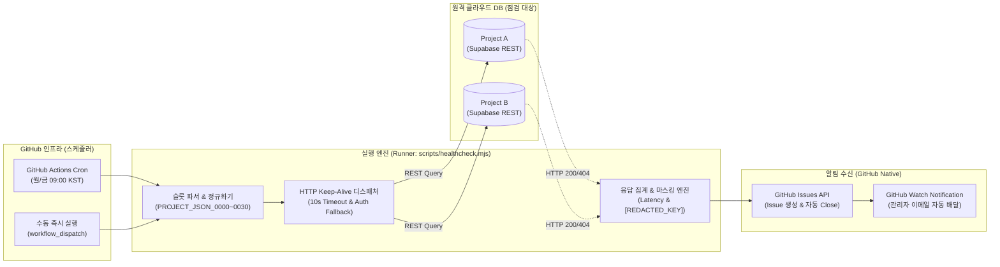
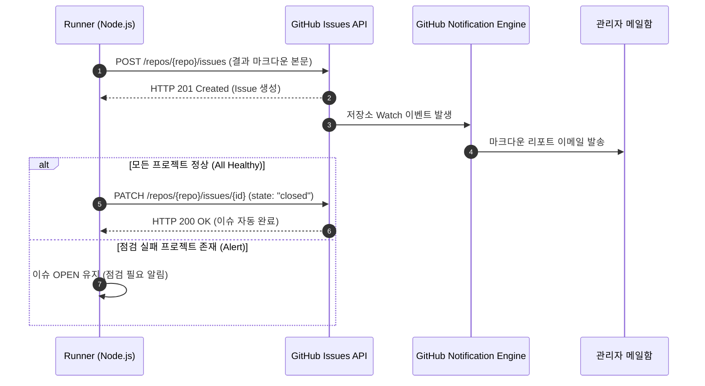

# Central Keep-Alive: GitHub Actions 기반 무과금 멀티 프로젝트 헬스체크 및 클라우드 휴면 방지 시스템

본 문서는 Supabase 등 클라우드 무료 티어 데이터베이스의 7일 비활성 자동 일시 정지(Inactivity Sleep/Pause)를 방지하고, 등록된 복수 프로젝트의 API 동작성을 주기적으로 점검하여 결과를 관리자에게 무과금으로 자동 보고하는 중앙 집중식 모니터링 시스템인 **Central Keep-Alive**의 구조와 구현 내용을 정리한 글입니다.

- **오픈소스 깃허브 저장소**: [https://github.com/AswinBlue/central-keepalive](https://github.com/AswinBlue/central-keepalive)
- **주요 실행 스택**: Node.js 20 (Zero-Dependency), GitHub Actions Workflow, GitHub Issues API, Supabase REST API

본 시스템은 개별 프로젝트 저장소마다 헬스체크 워크플로우를 중복 생성하지 않고, 독립된 중앙 저장소에서 복수의 외부 서비스 API를 일괄 점검하도록 구성되었습니다. 특히 외부 유료/무료 이메일 발송 서비스(Resend 등) 없이도, GitHub의 네이티브 알림(Issues 및 Repository Watch)을 활용하여 점검 결과를 관리자 이메일로 직접 전달받는 구조를 갖추고 있습니다.

---

## 1. 배경 및 핵심 설계 요구조건

### 1.1. 배경 및 문제 상황

Supabase 무료 플랜과 같은 클라우드 DB는 7일 동안 API 요청이나 데이터베이스 쿼리가 발생하지 않으면 인스턴스를 자동으로 일시 정지(Pause)시킵니다. 사용자가 오랜만에 서비스에 접속할 때 응답 지연이나 연결 실패가 발생할 수 있습니다.
또한 여러 프로젝트를 운영하는 환경에서 프로젝트마다 모니터링 워크플로우를 따로 구축하면 관리가 번거로워지며, 점검 결과를 메일로 받기 위해 외부 메일 발송 API를 연동할 경우 API 키 관리와 도메인 인증 등의 추가 작업이 필요합니다.

Central Keep-Alive는 이러한 문제를 해결하기 위해 다음 목표를 수립했습니다.

1. **운영 비용 0원 유지 (Zero-Cost)**: GitHub Actions 무료 플랜(월 2,000분 무료 중 주당 약 30초 소모) 내에서 상시 구동합니다.
2. **외부 서비스 의존성 배제 (Zero External Dependencies)**: 외부 메일 발송 SaaS 연동 없이 GitHub Issues와 저장소 Watch 알림을 통해 이메일을 수신하며, 외부 npm 라이브러리 없이 Node.js 20 내장 모듈만 사용합니다.
3. **독립된 중앙 집중식 관리 (Decoupled Central Hub)**: 개별 프로젝트 코드베이스에 부담을 주지 않고, 전용 모니터링 저장소에서 등록된 프로젝트들을 일괄 순회 점검합니다.
4. **시크릿 보안 유지 (Security-First)**: 모든 데이터베이스 URL과 인증 키는 소스코드에 커밋하지 않고 GitHub Repository Secrets로만 공급합니다.

### 1.2. 주요 기능 및 운영 흐름

시스템은 다음과 같은 기능과 절차로 동작합니다.

1. **슬롯 기반 프로젝트 등록 (`PROJECT_JSON_0000` ~ `PROJECT_JSON_0030`)**:
   프로젝트가 추가될 때마다 기존 설정을 수정할 필요 없이 새 GitHub Secret 슬롯을 등록하면 순차적으로 자동 탐색합니다.
2. **정기 스케줄러 실행 (주 2회)**:
   매주 월요일과 금요일 오전 09:00 KST(00:00 UTC)에 GitHub Actions Cron 스케줄러가 구동되어 러너 스크립트를 실행합니다. 수동 실행(`workflow_dispatch`)도 지원합니다.
3. **Keep-Alive 쿼리 및 폴백 점검**:
   각 프로젝트에 대해 1행 조회 쿼리(`/rest/v1/{table}?select=*&limit=1`)를 전송하여 DB 활동을 트리거하며, 테이블 404 시 인증 서비스(`/auth/v1/health`)로 폴백 점검합니다. 10초 타임아웃을 적용하여 무한 대기를 방지합니다.
4. **결과 집계 및 GitHub Issue 리포트 발행**:
   응답 속도(Latency ms)와 정상/실패 상태를 마크다운 표로 정리하여 GitHub Issue 및 GitHub Actions Job Summary에 기록합니다.
5. **네이티브 이메일 배달 및 이슈 자동 완료**:
   GitHub 저장소를 Watch 중인 관리자의 이메일로 리포트가 자동 배달됩니다. 모든 프로젝트가 정상이면 발행된 Issue를 즉시 자동 완료(`closed`) 처리하여 이슈 목록을 깔끔하게 유지합니다.

---



## 2. 시스템 아키텍처 및 상세 구현

### 2.1. 전체 시스템 아키텍처

Central Keep-Alive는 GitHub Actions 스케줄러, 실행 스크립트(`scripts/healthcheck.mjs`), 대상 클라우드 API, 그리고 GitHub Issue 리포터로 구성됩니다.



### 2.2. 시크릿 슬롯 파싱 엔진 (Secret Slot Parser)

다중 프로젝트 설정을 하나의 JSON 파일이나 단일 환경변수로 관리하면, 한 프로젝트의 설정을 수정하다 오타가 발생했을 때 전체 스케줄러가 멈추는 문제가 발생할 수 있습니다.
Central Keep-Alive는 `PROJECT_JSON_0000`부터 `PROJECT_JSON_0030`까지 인덱스 기반으로 슬롯을 독립 관리하는 구조를 적용했습니다.

```javascript
// 슬롯별 문자열을 안전하게 파싱하여 정규화된 프로젝트 배열 생성
export function parseProjectEntry(slotKey, rawValue) {
  if (!rawValue || typeof rawValue !== 'string' || !rawValue.trim()) {
    return [];
  }

  try {
    const parsed = JSON.parse(rawValue.trim());
    const items = Array.isArray(parsed) ? parsed : [parsed];
    const validProjects = [];

    for (let i = 0; i < items.length; i++) {
      const item = items[i];
      if (item && typeof item === 'object' && item.url && item.anonKey) {
        validProjects.push({
          name: item.name || `${slotKey}${items.length > 1 ? `_${i + 1}` : ''}`,
          url: String(item.url).replace(/\/$/, ''),
          anonKey: String(item.anonKey),
          endpoint: item.endpoint,
          table: item.table || 'queues',
        });
      } else {
        console.warn(`[WARN] Skipping invalid item in ${slotKey}: missing required 'url' or 'anonKey'`);
      }
    }
    return validProjects;
  } catch (err) {
    console.warn(`[WARN] Failed to parse ${slotKey}:`, err.message);
    return [];
  }
}
```

개별 슬롯의 JSON 형식이 깨져 있거나 필수 키가 없더라도 해당 슬롯만 건너뛰고 빈 배열을 반환하여, 다른 프로젝트의 점검 작업이 중단되지 않도록 보호합니다.

슬롯을 순차 스캔하는 함수는 빈 슬롯을 발견하면 순회를 조기 종료(Break)합니다.

```javascript
// PROJECT_JSON_0000부터 빈 슬롯 조우 시까지 순차 수집
export function collectProjectsFromSlots(env, startIdx = 0, maxIdx = 30, existingList = []) {
  const collected = [];

  for (let i = startIdx; i <= maxIdx; i++) {
    const slotKey = `PROJECT_JSON_${String(i).padStart(4, '0')}`;
    const rawVal = env[slotKey];

    // 빈 슬롯 조우 시 루프 종료
    if (!rawVal || !rawVal.trim()) {
      break;
    }

    const projectsFromSlot = parseProjectEntry(slotKey, rawVal);
    for (const proj of projectsFromSlot) {
      const isDuplicate = existingList.some(p => p.url === proj.url) ||
                          collected.some(p => p.url === proj.url);
      if (!isDuplicate) {
        collected.push(proj);
      }
    }
  }
  return collected;
}
```

또한 기존 단일 환경변수(`VITE_SUPABASE_URL`, `VITE_SUPABASE_ANON_KEY`)나 `ADDITIONAL_PROJECTS_JSON`, 로컬 개발용 `config/healthcheck-projects.json` 파일도 함께 인식하도록 하위 호환성을 유지했습니다.

### 2.3. HTTP Keep-Alive 디스패처 및 2단 헬스체크 폴백

원격 DB의 비활성 슬립을 방어하기 위해 실제 데이터베이스 엔진을 깨우는 HTTP GET 요청을 전송합니다. 기본 테이블 조회가 404를 반환하면 인증 헬스체크 엔드포인트(`/auth/v1/health`)로 자동 폴백합니다.

```javascript
// Keep-Alive 쿼리 전송 및 404 폴백 처리
let endpoint = resolveEndpoint(proj);
let res = await fetch(endpoint, {
  method: 'GET',
  headers: {
    'apikey': proj.anonKey,
    'Authorization': `Bearer ${proj.anonKey}`,
  },
  signal: AbortSignal.timeout(10000), // 10초 타임아웃
});

// 커스텀 테이블 404 반환 시 인증 엔드포인트로 자동 폴백
if (res.status === 404 && !proj.endpoint && !proj.table) {
  const fallbackEndpoint = `${proj.url}/auth/v1/health`;
  const fallbackRes = await fetch(fallbackEndpoint, {
    method: 'GET',
    headers: { 'apikey': proj.anonKey },
    signal: AbortSignal.timeout(10000),
  });
  if (fallbackRes.ok) {
    res = fallbackRes;
  }
}
```

모든 네트워크 호출에는 `AbortSignal.timeout(10000)`이 지정되어 특정 엔드포인트가 무응답 상태에 빠져도 최대 10초 내에 타임아웃 예외로 처리되고 다음 프로젝트 점검으로 진행됩니다.

### 2.4. GitHub Native Issue 및 이메일 알림 연동

외부 메일 API를 쓰지 않고 점검 결과를 전달하기 위해 GitHub Issues와 저장소 알림 시스템을 활용합니다.



GitHub Actions 러너는 기본 제공되는 `GITHUB_TOKEN`을 사용하여 새 Issue를 생성하고, 저장소를 Watch(All Activity)하고 있는 관리자의 이메일로 리포트 전문이 자동 전송됩니다. 모든 프로젝트가 정상인 경우 Issue를 즉시 `closed` 처리하여 저장소의 오픈 이슈 목록이 불필요하게 쌓이지 않도록 관리합니다.

---



## 3. 주요 트러블슈팅 및 보안 조치

프로젝트 개발 과정에서 발생했던 실제 문제들과 이를 해결한 보안 조치 내역입니다.

### 3.1. 단일 환경변수 관리 위험과 슬롯 분할 전환

- **문제점**: 초기에 다중 프로젝트 정보를 `ADDITIONAL_PROJECTS_JSON`이라는 단일 Secret 내에 거대한 JSON 배열로 관리했습니다. 프로젝트를 추가할 때마다 기존 전체 설정을 열어 수정해야 했고, JSON 문법 오류가 발생하면 등록된 모든 프로젝트의 점검이 일괄 실패하는 문제가 있었습니다.
- **조치 내용**: `PROJECT_JSON_0000`부터 `PROJECT_JSON_0030`까지 독립된 Secret 슬롯으로 분할했습니다. 새 프로젝트 추가 시 기존 설정을 건드리지 않고 새 Secret만 추가하면 되며, 특정 슬롯의 JSON 오류가 다른 프로젝트에 영향을 주지 않도록 격리했습니다.

### 3.2. Git 커밋 이력 내 설정 파일 격리 및 히스토리 스크럽

- **문제점**: 로컬 테스트용 설정 파일(`config/healthcheck-projects.json`)과 README 예시에 실제 URL과 키가 포함된 상태로 로컬 커밋이 생성된 적이 있었습니다. 단순히 파일을 삭제하거나 덮어쓰는 커밋을 추가하더라도 과거 Git 커밋 로그에 파일 내용이 남는 위험이 존재했습니다.
- **조치 내용**: 부모 커밋이 없는 고아 브랜치(`clean_main`)를 생성하여 과거 커밋 로그를 영구 파기(Purge)하고, 예시 파일의 키를 플레이스홀더(`your-project-id`, `your-anon-key`)로 정제한 뒤 `.gitignore`에 `.env*` 및 `config/healthcheck-projects.json`을 등록하여 단일 루트 커밋으로 원격에 강제 푸시했습니다.

### 3.3. 에러 메시지 내 API Key 노출 방지 마스킹

- **문제점**: 원격 API에서 401/403 등 오류가 발생할 때 반환되는 에러 본문 텍스트에 요청에 사용된 키 문자열이 포함되어 반환되는 경우가 있었습니다. 이 문자열이 GitHub Issue 본문이나 Actions 요약에 그대로 노출될 위험이 있었습니다.
- **조치 내용**: 에러 응답 텍스트를 마크다운에 삽입하기 전에 정규식 필터를 적용하여 민감한 키 패턴을 `[REDACTED_KEY]`로 자동 마스킹 치환하도록 구현했습니다.

```javascript
// 민감 토큰 패턴 감지 및 마스킹 처리
const text = await res.text();
const sanitizedText = text
  .replace(/sb_publishable_[0-9A-Za-z_-]+/g, '[REDACTED_KEY]')
  .slice(0, 100);
message = `HTTP ${res.status}: ${sanitizedText}`;
```

### 3.4. 종합 보안 점검 결과

운영 전 6대 핵심 영역에 대한 보안 점검을 진행했습니다.

| 점검 영역 | 세부 항목 | 결과 | 내용 |
| :--- | :--- | :---: | :--- |
| **1. 공급망 (SBOM/CVE)** | 외부 패키지 취약점 | **PASS** | 서드파티 의존성 0개 (`dependencies: {}`), Node 20 내장 모듈만 사용 |
| **2. Git 기밀 유출** | 워킹트리 및 커밋 로그 내 시크릿 잔존 | **PASS** | 단일 무결성 루트 커밋 재구성 및 정규식 전수 스캔 완료 |
| **3. 통신 인터페이스** | HTTPS 강제 및 타임아웃 가드 | **PASS** | 모든 엔드포인트 HTTPS 강제, 10초 타임아웃, 토큰 마스킹 적용 |
| **4. 데이터 생명주기** | 비즈니스 데이터 저장 여부 | **PASS** | 비즈니스 데이터 저장 0%, 런타임 메모리에서 메타 쿼리만 수행 |
| **5. 암호화 안전성** | 통신 암호화 프로토콜 | **PASS** | TLS 1.3 / HTTPS 통신 준수, 폐기된 취약 알고리즘 미사용 |
| **6. Key 격리 및 관리** | 보안 Key 보관 및 주입 방식 | **PASS** | GitHub Repository Secrets 전용 격리 완료 |

---

## 4. 결론

Central Keep-Alive는 복잡한 유료 SaaS 없이 GitHub Actions와 GitHub Issues의 기본 기능만으로 클라우드 DB 휴면 방지와 정기 헬스체크 알림을 무과금으로 해결한 시스템입니다.

- **비용 및 의존성 최소화**: GitHub Actions 무료 실행 시간과 GitHub Watch 이메일 알림을 결합하여 추가 비용과 외부 의존성 없이 시스템을 완성했습니다.
- **운영 안정성 확보**: 슬롯 기반 Secret 관리로 설정 추가 시 기존 설정을 보존하고, 개별 프로젝트 파싱 오류를 격리했습니다.
- **보안성 유지**: 외부 패키지 없는 경량 런타임 구성, 정규식 에러 마스킹, 그리고 GitHub Secrets 기반 키 격리를 적용했습니다.

본 시스템의 전체 소스코드와 상세 설정 방법은 [Central Keep-Alive GitHub 저장소](https://github.com/AswinBlue/central-keepalive)에서 확인할 수 있습니다.
