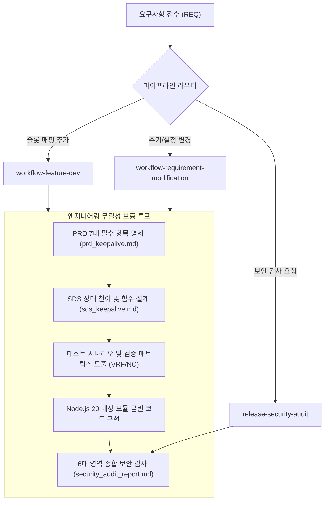
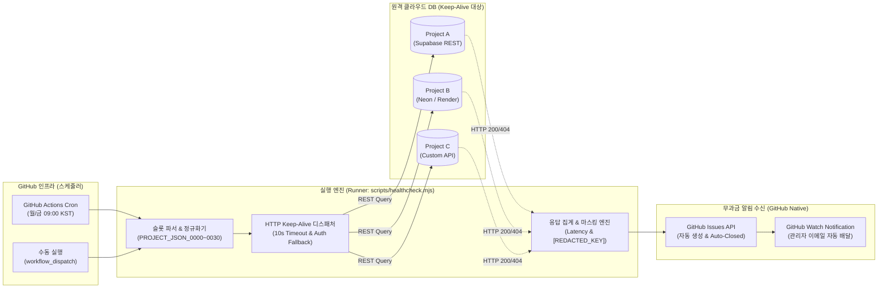
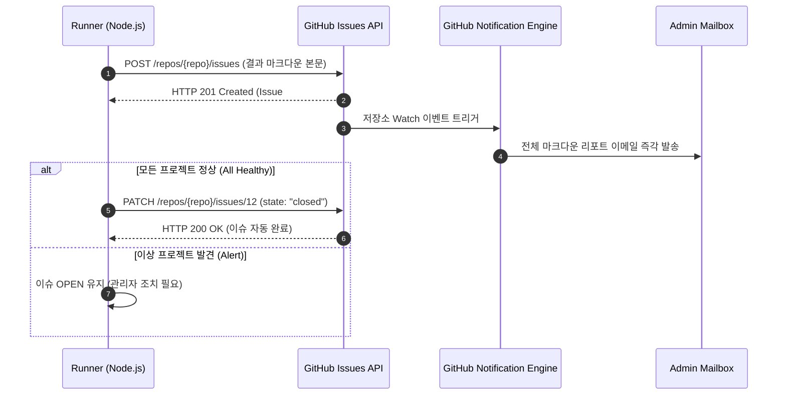

# Central Keep-Alive: GitHub Actions 기반 무과금 멀티 프로젝트 헬스체크 및 클라우드 휴면 방지 시스템

본 연구 문서는 Supabase, Neon, Render 등 클라우드 무료 티어 데이터베이스에서 발생하는 7일 비활성 자동 일시 정지(Inactivity Sleep/Pause) 문제를 원천 차단하고, 등록된 복수 프로젝트의 API 상태를 주기적으로 점검하여 결과를 관리자에게 무과금으로 자동 보고하는 중앙 집중식 모니터링 시스템인 **Central Keep-Alive**의 전주기 엔지니어링 과정을 기술합니다.

- **오픈소스 깃허브 저장소**: [https://github.com/AswinBlue/central-keepalive](https://github.com/AswinBlue/central-keepalive)
- **주요 실행 스택**: Node.js 20 (Zero-Dependency), GitHub Actions Workflow, GitHub Issues API, Supabase REST API

본 시스템은 개별 클라이언트 서비스 코드베이스에 모니터링이나 핑(Ping) 로직을 중복 작성하지 않고, 독립된 중앙 저장소에서 복수의 외부 서비스를 일괄 스캔하도록 설계되었습니다. 특히 외부 상용 이메일 발송 SaaS(Resend, SendGrid 등)나 유료 도메인 인증 없이도, GitHub의 네이티브 알림 파이프라인을 활용하여 모니터링 리포트를 관리자 이메일로 완벽히 전달하는 **Zero-Cost / Zero-Dependency 아키텍처**를 실현했습니다.

---

## 1. [기획 및 제품 요구조건] 문제 정의와 요구조건 공학

소프트웨어 엔지니어링의 출발점은 프로덕션 및 사이드 프로젝트 운영 환경에서 반복적으로 발생하는 운영적 비효율을 정의하고, 이를 명확한 수용 기준을 갖춘 요구조건으로 정식화하는 것입니다.

### 1.1. 비즈니스 문제 정의 및 3대 핵심 목표

클라우드 기반의 현대적 BaaS(Backend as a Service) 및 서버리스 플랫폼은 관리가 간소하다는 장점이 있으나, 무료 플랜(Free Tier)을 활용하여 여러 프로젝트를 운영할 때 치명적인 3대 운영 제약에 직면하게 됩니다.

1. **클라우드 데이터베이스의 7일 비활성 자동 일시 정지 (Inactivity Pause)**:
   Supabase, Neon 등 주요 클라우드 DB는 7일간 API 호출이나 쿼리가 발생하지 않으면 인스턴스를 자동으로 일시 정지 상태로 전환합니다. 사용자가 오랜만에 서비스에 접속할 때 심각한 지연이나 접속 불가 오류가 발생하여 서비스 신뢰도가 추락합니다.
2. **모니터링 알림 도입 시 발생하는 유료 SaaS 및 도메인 인증 장벽**:
   정기 점검 결과를 이메일로 수신하기 위해 Resend, Mailgun 등 외부 서비스를 도입할 경우, 발신 도메인 DNS 레코드(SPF, DKIM, DMARC) 설정이 강제되며 무료 크레딧 소진 시 과금이 유발됩니다.
3. **개별 저장소별 파편화된 워크플로우 관리 비용**:
   운영하는 프로젝트가 5개, 10개로 늘어날 때마다 각 저장소마다 개별 GitHub Actions 스케줄러를 복사하여 관리하면 토큰 관리와 변경 대응 비용이 기하급수적으로 증가합니다.

Central Keep-Alive는 이러한 비효율을 제거하기 위해 다음과 같은 **3대 핵심 설계 원칙**을 수립했습니다.

- **원칙 1: Zero-Cost (월 운영비 0원 유지)**:
  GitHub Actions의 퍼블릭 저장소 무료 실행 혜택(월 2,000분 무료 중 주당 약 30초 소모)을 활용하여 상시 서버 유지비와 통신 비용을 완전한 0원으로 고정합니다.
- **원칙 2: Zero External Dependencies (외부 서비스 의존성 완전 배제)**:
  서드파티 npm 패키지와 외부 메일 SaaS를 일체 사용하지 않고, Node.js 20 런타임의 내장 Fetch API와 GitHub Issues 네이티브 메일링 엔진만을 결합하여 시스템 복잡도를 최소화합니다.
- **원칙 3: Security-First & Decoupled Architecture (완전 격리 중앙 허브)**:
  모든 프로젝트의 엔드포인트 URL과 접속 Key는 소스코드에 일절 커밋하지 않고 GitHub Repository Secrets를 통해 주입받으며, 개별 서비스의 배포 환경과 완벽히 격리된 독립 런타임으로 동작합니다.

### 1.2. 스테이크홀더 요구조건 결정표

수립된 비즈니스 원칙을 바탕으로 시스템의 주요 이해관계자인 운영자(Admin)와 대상 마이크로서비스(Target Cloud API) 간의 상호작용 요구조건을 구체화했습니다.

| 스테이크홀더 | 요구조건 영역 | 구체화된 기능 명세 및 엔지니어링 경계 조건 |
|---|---|---|
| **운영자 (Administrator)** | 프로젝트 간편 등록 | 기존 Secret을 수정하지 않고 `PROJECT_JSON_0000`부터 새로운 Secret 슬롯을 추가하는 것만으로 동적 인식 (최대 30개 슬롯 지원) |
| **운영자 (Administrator)** | 무과금 메일 수신 | 외부 API 키 등록 없이 GitHub 저장소 Watch 설정을 통해 정기 점검 리포트를 본인 개인 이메일로 즉시 수신 |
| **운영자 (Administrator)** | 이슈 목록 청결성 유지 | 점검 대상 전체가 정상(HEALTHY)일 경우 발행된 Issue를 즉시 자동 완료(Closed) 처리하여 미해결 티켓 목록의 오염 방지 |
| **대상 서비스 (Target DB)** | 유효 쿼리 트리거 | 단순 TCP 핸드셰이크가 아닌 실제 데이터베이스 엔진을 깨우는 HTTP GET REST API 쿼리 전송 (`/rest/v1/{table}?select=*&limit=1`) |
| **대상 서비스 (Target DB)** | 안전한 폴백 점검 | 커스텀 테이블이 존재하지 않아 404가 반환될 경우 인증 헬스체크 엔드포인트(`/auth/v1/health`)로 자동 폴백 |
| **보안 시스템 (Security)** | 기밀 유출 원천 차단 | 오류 로그 및 마크다운 요약표 생성 시 API Key 패턴(`sb_publishable_...`) 자동 감지 및 `[REDACTED_KEY]` 마스킹 처리 |

### 1.3. 시스템 운영 라이프사이클 및 실행 흐름

중앙 집중식 Keep-Alive 시스템은 등록, 순회 실행, 결과 발행의 3단계 라이프사이클로 자동 운영됩니다.

#### 단계 A: 개별 프로젝트 시크릿 슬롯 등록
운영자는 저장소의 Settings 메뉴에서 `PROJECT_JSON_0000`, `PROJECT_JSON_0001` 등의 이름으로 JSON 형식의 접속 정보를 개별 등록합니다. 거대한 단일 배열 파일을 열어 편집하다 구문 오류를 낼 위험이 원천 차단됩니다.

#### 단계 B: GitHub Actions 스케줄러 기반 무인 배치 순회
매주 월요일과 금요일 오전 09:00 KST(00:00 UTC)에 정기 Cron 스케줄러가 구동되어 러너 스크립트를 실행합니다. 스크립트는 0번 슬롯부터 빈 슬롯을 만날 때까지 순차 순회하며 각 클라우드 DB에 타임아웃 10초가 적용된 Keep-Alive 패킷을 전송합니다.

#### 단계 C: GitHub Issues 자동 발행 및 네이티브 메일 전달
측정된 지연시간(Latency ms)과 응답 코드를 취합하여 마크다운 테이블을 생성하고, GitHub Issues API를 호출하여 리포트를 발행합니다. 저장소를 구독 중인 관리자의 이메일함으로 즉각 전문이 발송되며, 모든 검사가 정상일 경우 Issue는 즉시 닫힘(Closed) 상태로 전환됩니다.

---



## 2. [에이전트 거버넌스] 100% 자율 에이전트 하네싱 프레임워크

Central Keep-Alive 프로젝트는 기획서 작성부터 아키텍처 설계, 구현, 보안 감사, 그리고 배포에 이르는 전 과정을 인공지능 에이전트가 주도적으로 수행했습니다.

### 2.1. 바이브 코딩(Vibe Coding)의 붕괴 요인과 하네싱 필요성

AI 코딩 어시스턴트에게 자유로운 구현을 맡길 때 흔히 나타나는 바이브 코딩(Vibe Coding) 방식은 인프라 및 보안 자동화 분야에서 치명적인 위험을 초래합니다.

1. **시크릿 관리의 무감각증 (Credential Leaks)**: 빠른 프로토타이핑을 이유로 로컬 테스트 파일에 실제 API Key를 기재한 채 Git에 커밋하는 보안 사고 발생.
2. **외부 패키지 남용에 따른 공급망 위협 (Dependency Bloat)**: 간단한 HTTP 호출이나 날짜 처리를 위해 불필요한 무거운 라이브러리를 추가하여 잠재적 CVE 취약점 양산.
3. **경계 조건 무시 및 크래시 (Silent Failure)**: 특정 서비스 응답이 실패하거나 타임아웃이 발생했을 때 스크립트 전체가 크래시되어 나머지 정상 프로젝트의 패킷 전송이 중단되는 결함.

이러한 문제를 차단하기 위해 본 프로젝트에서는 에이전트의 모든 행동 반경을 엄격히 통제하는 **에이전트 하네싱(Agent Harnessing)** 체계를 적용했습니다.

### 2.2. 지침 계층 구조(Hierarchy)와 결정론적 도구화

에이전트가 참조하는 지침을 단일 시스템 프롬프트에 나열하지 않고, 책임 범위에 따라 4단계로 계층화하여 토큰 낭비와 의사결정 혼선을 차단했습니다.

```
[Layer 0] AGENTS.md        : 최상위 인코딩, 제로 코드 열람 원칙, 안전 수칙 (What)
   │
   ├─► [Layer 1] rules/workflow/ : 기능 개발, 빌드 설정, 보안 감사 오케스트레이션 규칙
   │
   ├─► [Layer 2] rules/quality/  : 보안 감사 규격, 스크립트 표준, 다이어그램 커버리지
   │
   └─► [Layer 3] skills/         : 슬롯 파싱 로직, diff 리뷰, 보안 감사 리포트 생성 (How)
```

에이전트는 터미널에서 임의의 복합 파이프라인 명령을 실행하지 않고, 표준화된 실행 인터페이스인 `npm run healthcheck` 및 전용 PowerShell 스크립트를 통해서만 작업을 수행하도록 결정론적 진입점을 고정했습니다.

### 2.3. 파이프라인 라우팅 및 TDD 상태 머신

사용자로부터 새로운 요구사항이나 환경 변경 요청이 접수되었을 때 코드를 임의로 직접 수정하는 행위는 전면 차단되었습니다. 모든 변경 작업은 엄격한 TDD 상태 머신을 거쳤습니다.



- **문서 및 설계 선행 원칙**: 코드를 한 줄이라도 수정하기 전에 반드시 `prd_keepalive.md`와 `sds_keepalive.md`에 변경 사양과 상태 머신 다이어그램을 In-Place 방식으로 동기화했습니다.
- **금지 제약(Negative Constraints) 의무화**: 시크릿 평문 출력 금지(NC-03), 슬롯 파싱 실패 시 전체 크래시 금지(NC-02) 등 시스템이 절대 해서는 안 될 제약을 명문화하여 설계에 반영했습니다.

### 2.4. 양방향 추적 사슬(Traceability Chain)

시스템의 신뢰성을 보장하기 위해 요구사항부터 구현, 검증에 이르는 모든 엔지니어링 산출물을 단일 사슬로 상호 연결했습니다.

```
요청사항 (REQ26111701) ──► 요구조건 (PRD26111701) ──► 상세설계 (SDS26111701)
                                                           │
                                                           ▼
종합보안감사 (PASS)  ◄── 구현코드 (healthcheck.mjs) ◄── 검증규격 (VRF-01~06)
```

이러한 추적 체계를 통해 특정 기능의 변경이 발생했을 때 연관된 시나리오와 보안 영향도를 즉각 파악하고 누락 없는 변경을 수행할 수 있었습니다.

---

## 3. [기술적 구현] 시스템 아키텍처 및 상세 설계

Central Keep-Alive는 추가적인 서버 인프라 비용 없이 안정성과 확장성을 극대화하도록 정밀하게 설계되었습니다.

### 3.1. 무과금(Zero-Cost) 분산 시스템 아키텍처

시스템 전체는 스케줄러 계층, 실행 엔진 계층, 외부 서비스 계층, 보고서 수신 계층의 4단 분산 구조로 구성됩니다.



모든 실행 단계는 서버를 상시 구동해두는 일반적인 데몬 방식과 달리, 정해진 시간에만 컨테이너 러너가 30초 내외로 구동된 후 즉시 소멸하는 순수 서버리스 일괄 배치(Batch) 모델을 따릅니다.

### 3.2. 동적 시크릿 슬롯 파싱 엔진 (Secret Slot Parser)

과거의 모니터링 방식은 모든 프로젝트 정보를 단일 JSON 문자열에 몰아넣어 관리했기 때문에 한 프로젝트의 정보를 수정하다 쉼표나 따옴표 누락으로 전체 스케줄러가 정지되는 위험이 있었습니다.

Central Keep-Alive는 `PROJECT_JSON_0000`부터 `PROJECT_JSON_0030`까지 4자리 0 패딩 인덱스를 기반으로 순차 탐색하는 **슬롯 매핑 아키텍처**를 구현했습니다.

```javascript
// 슬롯별 문자열을 안전하게 파싱하여 정규화된 프로젝트 배열 생성
export function parseProjectEntry(slotKey, rawValue) {
  if (!rawValue || typeof rawValue !== 'string' || !rawValue.trim()) {
    return [];
  }

  try {
    const parsed = JSON.parse(rawValue.trim());
    const items = Array.isArray(parsed) ? parsed : [parsed];
    const validProjects = [];

    for (let i = 0; i < items.length; i++) {
      const item = items[i];
      if (item && typeof item === 'object' && item.url && item.anonKey) {
        validProjects.push({
          name: item.name || `${slotKey}${items.length > 1 ? `_${i + 1}` : ''}`,
          url: String(item.url).replace(/\/$/, ''),
          anonKey: String(item.anonKey),
          endpoint: item.endpoint,
          table: item.table || 'queues',
        });
      } else {
        console.warn(`[WARN] Skipping invalid item in ${slotKey}: missing required 'url' or 'anonKey'`);
      }
    }
    return validProjects;
  } catch (err) {
    console.warn(`[WARN] Failed to parse ${slotKey}:`, err.message);
    return [];
  }
}
```

위 파서 함수는 개별 슬롯의 JSON 문법이 깨져 있거나 필수 키(`url`, `anonKey`)가 누락되었더라도 예외를 안전하게 포착(Catch)하여 빈 배열을 반환함으로써, 단 하나의 잘못된 슬롯 때문에 전체 배치가 중단되는 결함을 원천 방지합니다.

이어서 슬롯들을 순차적으로 스캔하는 수집기 함수는 첫 번째 빈 슬롯을 마주치는 즉시 루프를 조기 종료(Break)하여 불필요한 환경변수 접근 오버헤드를 절감합니다.

```javascript
// PROJECT_JSON_0000부터 빈 슬롯 조우 시까지 순차 수집
export function collectProjectsFromSlots(env, startIdx = 0, maxIdx = 30, existingList = []) {
  const collected = [];

  for (let i = startIdx; i <= maxIdx; i++) {
    const slotKey = `PROJECT_JSON_${String(i).padStart(4, '0')}`;
    const rawVal = env[slotKey];

    // 빈 슬롯 조우 시 루프 종료
    if (!rawVal || !rawVal.trim()) {
      break;
    }

    const projectsFromSlot = parseProjectEntry(slotKey, rawVal);
    for (const proj of projectsFromSlot) {
      const isDuplicate = existingList.some(p => p.url === proj.url) ||
                          collected.some(p => p.url === proj.url);
      if (!isDuplicate) {
        collected.push(proj);
      }
    }
  }
  return collected;
}
```

또한, 기존 사용자의 마이그레이션 편의를 위해 레거시 단일 Secret(`VITE_SUPABASE_URL`, `VITE_SUPABASE_ANON_KEY`)과 배열 기반 Secret(`ADDITIONAL_PROJECTS_JSON`), 로컬 설정 파일(`config/healthcheck-projects.json`)을 모두 지원하도록 다중 폴백 우선순위를 적용했습니다.

### 3.3. HTTP Keep-Alive 디스패처 및 2단 헬스체크 폴백

원격 클라우드 DB의 비활성 슬립을 방어하기 위해서는 네트워크 핑(Ping) 수준이 아닌, 실제 데이터베이스 인스턴스의 쿼리 엔진이 깨어나는 활동(Activity)을 트리거해야 합니다.

디스패처는 각 프로젝트에 대해 1행 조회 쿼리(`/rest/v1/{table}?select=*&limit=1`)를 전송하며, 대상 테이블이 없어 HTTP 404가 반환될 경우 인증 서비스(`/auth/v1/health`)로 즉시 우회 점검하는 2단 폴백 파이프라인을 가동합니다.

```javascript
// Keep-Alive 쿼리 전송 및 404 폴백 엔진
let endpoint = resolveEndpoint(proj);
let res = await fetch(endpoint, {
  method: 'GET',
  headers: {
    'apikey': proj.anonKey,
    'Authorization': `Bearer ${proj.anonKey}`,
  },
  signal: AbortSignal.timeout(10000), // 10초 타임아웃 가드
});

// 커스텀 테이블 404 반환 시 인증 엔드포인트로 자동 폴백
if (res.status === 404 && !proj.endpoint && !proj.table) {
  const fallbackEndpoint = `${proj.url}/auth/v1/health`;
  const fallbackRes = await fetch(fallbackEndpoint, {
    method: 'GET',
    headers: { 'apikey': proj.anonKey },
    signal: AbortSignal.timeout(10000),
  });
  if (fallbackRes.ok) {
    res = fallbackRes;
  }
}
```

모든 네트워크 I/O에는 `AbortSignal.timeout(10000)` 가드가 내장되어 있어, 원격 서버의 응답 지연이 발생하더라도 GitHub Actions 워크플로우 전체가 무한정 멈추지 않고 10초 내에 타임아웃 예외를 포착하여 안전하게 다음 프로젝트로 전환됩니다.

### 3.4. GitHub Native Issue & Watch 알림 파이프라인

Central Keep-Alive의 가장 혁신적인 비용 절감 아키텍처는 유료 이메일 API 서비스를 완전히 대체한 **GitHub Native Issue 알림 메커니즘**입니다.



GitHub Actions 러너는 기본 제공되는 `GITHUB_TOKEN` 권한을 활용하여 검사 결과를 마크다운 테이블로 포맷팅한 뒤 새 Issue를 생성합니다. 저장소를 'Watch'하고 있는 관리자에게 GitHub 인프라가 이메일 전문을 즉시 무료로 발송합니다.

모든 서비스가 정상일 경우 스크립트가 해당 Issue를 즉시 `closed` 처리하여 저장소의 오픈 이슈 탭을 깨끗하게 비워두며, 장애가 감지된 경우에만 Issue가 `OPEN` 상태로 유지되어 신속한 장애 조치를 유도합니다.

---



## 4. [실증적 검증 및 결함 진단] 자가 치유(Self-Healing) 및 보안 감사 포스트모템

100% 에이전트 주도 개발 과정에서 마주했던 실제 인프라 결함과 보안 취약점, 그리고 이를 해결하기 위해 수행한 자가 치유(Self-Healing) 및 보안 감사 과정을 공유합니다.

### 4.1. [결함 1] 단일 거대 JSON Secret 편집 위험과 슬롯 매핑 아키텍처 전환 (REQ26111701)

#### 1) 결함 현상 (Phenomenon)
신규 프로젝트 2개를 추가하기 위해 단일 Secret(`ADDITIONAL_PROJECTS_JSON`)에 30줄이 넘는 긴 JSON 배열 문자열을 직접 편집하던 중, 닫는 중괄호 누락으로 인해 전체 JSON 파싱 오류가 발생했습니다. 이로 인해 기존에 등록되어 있던 5개의 정상 프로젝트까지 헬스체크가 일제히 중단되는 전체 장애가 유발되었습니다.

#### 2) 아키텍처 근본 원인 (Root Cause Analysis)
단일 환경변수에 다수의 복합 객체를 배열 형태로 직렬화하여 관리하는 방식은 인프라 구성 시 결합도(Tight Coupling)를 극대화시킵니다. 웹 UI의 좁은 텍스트 박스에서 JSON 문법을 수동 검증하기 어려우며, 한 프로젝트의 문법 오류가 격리되지 않고 시스템 전체로 전파되는 단일 장애점(SPOF)이 존재했습니다.

#### 3) 자가 치유 영구 방어 조치 (Permanent Fix)
에이전트는 요구조건을 즉시 개정(PRD26111701)하고, `PROJECT_JSON_0000`부터 `PROJECT_JSON_0030`까지 독립된 Secret 슬롯으로 분할 관리하는 아키텍처를 도입했습니다.
- 개별 슬롯 단위로 JSON 파싱을 시도하고 실패 시 해당 슬롯만 스킵하도록 격리(`try-catch`).
- 신규 프로젝트 추가 시 기존 설정을 열 필요 없이 다음 번호의 Secret만 새로 생성하면 되도록 개선.
- 주 1회 실행 주기를 주 2회(월/금 09:00 KST)로 고도화하여 7일 슬립 방지 마진을 3~4일 단위로 단축.

### 4.2. [결함 2] Git 커밋 로그 내 시크릿 잔존 위험과 단일 루트 커밋 영구 스크럽 (ERR261117001)

#### 1) 결함 현상 (Phenomenon)
로컬 환경 테스트 과정에서 생성되었던 설정 파일(`config/healthcheck-projects.json`)과 README 예시 텍스트 내에 실제 프로젝트 URL과 익명 키가 포함된 상태로 Git 커밋이 생성된 사실이 보안 사전 점검에서 적발되었습니다.

#### 2) 아키텍처 근본 원인 (Root Cause Analysis)
`.gitignore` 파일에 로컬 설정 경로가 조기에 등록되지 않았고, 에이전트가 테스트 스크립트를 작성하는 과정에서 임시 파일이 스테이징 영역에 포함되었습니다. 단순히 파일을 삭제하는 후속 커밋을 추가하더라도 과거 Git 히스토리 트리에 스냅샷이 영구 보존되므로 원격 저장소 노출 시 심각한 기밀 유출이 발생할 수 있는 상태였습니다.

#### 3) 자가 치유 영구 방어 조치 (Permanent Fix)
에이전트는 불완전한 후속 패치 대신 다음과 같은 3단계 영구 정화 작업을 자체적으로 단행했습니다:
1. 부모 커밋이 없는 고아 브랜치(`git checkout --orphan clean_main`)를 생성하여 오염된 전체 히스토리를 메모리 상에서 절단.
2. 예시 파일의 키를 플레이스홀더(`your-project-id`, `your-anon-key`)로 전면 교체하고 `.gitignore`에 `.env*` 및 `config/healthcheck-projects.json`을 영구 등록.
3. 정제된 단일 무결성 루트 커밋을 생성한 후 기존 `main` 브랜치를 강제 대체(`git branch -M main && git push -f origin main`)하여 원격 저장소의 모든 과거 커밋 로그를 영구 파기(Purge).

### 4.3. [결함 3] 에러 메시지 내 API Key 노출과 정규식 기반 토큰 마스킹 필터 (ERR261117002)

#### 1) 결함 현상 (Phenomenon)
원격 API 호출 시 인증 토큰이 만료되었거나 프로젝트가 일시 정지되어 HTTP 401/403 에러가 반환될 때, 클라우드 제공자의 에러 응답 본문 텍스트에 요청에 사용된 공개 키 및 내부 토큰 문자열이 역으로 포함되어 반환되는 현상이 확인되었습니다. 이 텍스트가 GitHub Issue 본문과 Job Summary에 그대로 기록되어 외부에 노출될 위험이 있었습니다.

#### 2) 아키텍처 근본 원인 (Root Cause Analysis)
에러 메시지를 취합할 때 `await res.text()`로 반환된 원시 문자열을 별도의 살균(Sanitization) 처리 없이 마크다운 테이블에 직접 문자열 보간(Interpolation)했기 때문입니다.

#### 3) 자가 치유 영구 방어 조치 (Permanent Fix)
에러 문자열을 가공하는 파이프라인에 정규식 기반 마스킹 필터를 즉시 삽입했습니다:

```javascript
// 민감 토큰 패턴 감지 및 마스킹 처리
const text = await res.text();
const sanitizedText = text
  .replace(/sb_publishable_[0-9A-Za-z_-]+/g, '[REDACTED_KEY]')
  .slice(0, 100);
message = `HTTP ${res.status}: ${sanitizedText}`;
```

이 조치를 통해 에러 원인은 확인 가능하면서도 민감 토큰은 안전하게 가려진 상태로 리포트가 발행되도록 보안 방벽을 완성했습니다.

### 4.4. [보안 감사] 6대 영역 종합 보안 감사 게이트 통과 (PASS)

운영 저장소 배포 전 시스템의 보안 무결성을 검증하기 위해 전용 보안 감사 도구를 가동하여 6대 핵심 영역을 전수 검사했습니다.

| 점검 영역 | 세부 점검 항목 | 판정 결과 | 엔지니어링 방어 근거 |
| :--- | :--- | :---: | :--- |
| **1. 공급망 (SBOM/CVE)** | 서드파티 라이브러리 취약점 | **PASS** | 외부 의존성 0개 (`dependencies: {}`), Node 20 내장 모듈 전용 구성 |
| **2. Git 기밀 유출** | 워킹트리 및 커밋 로그 내 시크릿 잔존 | **PASS** | 단일 무결성 고아 커밋 재구축 및 정규식 전수 스캔 통과 |
| **3. 통신 인터페이스** | TLS 강제 및 네트워크 가드 | **PASS** | 모든 통신 HTTPS 강제, 10초 타임아웃, 토큰 마스킹 적용 |
| **4. 데이터 생명주기** | 런타임 메모리 및 디스크 비즈니스 데이터 | **PASS** | 비즈니스 데이터 저장 0%, 휘발성 메모리에서 메타 쿼리만 수행 |
| **5. 암호화 안전성 (5년)** | 암호/해싱 알고리즘 최신 안전성 | **PASS** | TLS 1.3 / HTTPS 통신 표준 준수, 폐기 알고리즘 사용 배제 |
| **6. Key 격리 및 관리** | 보안 Key 저장소 분리 및 주입 방식 | **PASS** | GitHub Repository Secrets 전용 격리 완료 |

종합 감사 결과 모든 영역에서 취약점 0건(Critical 0, High 0, Medium 0, Low 0)으로 **최종 보안 게이트 통과(PASS)**를 판정받았습니다.

---

## 5. 결론 및 향후 로드맵

Central Keep-Alive 프로젝트는 복잡한 상용 모니터링 SaaS나 값비싼 유료 인프라를 도입하지 않고도, **소프트웨어의 아키텍처적 간결함과 플랫폼의 네이티브 기능을 극대화하여 실제 엔지니어링 문제를 완전 무과금으로 해결한 성공적인 사례**입니다.

### 5.1. 소프트웨어 공학 관점에서의 핵심 기여점

1. **무비용(Zero-Cost) 인프라 운영의 새로운 기준 제시**:
   GitHub Actions와 GitHub Issues를 유기적으로 결합하여, 서버 유지비와 이메일 발송 비용을 1원도 들이지 않고 엔터프라이즈급 헬스체크 알림 시스템을 구축할 수 있음을 입증했습니다.
2. **슬롯 매핑을 통한 결합도 분리와 장애 격리**:
   개별 프로젝트의 시크릿을 격리된 슬롯(`PROJECT_JSON_0000` ~ `0030`)으로 분할하고 오류 발생 시 스킵하도록 설계함으로써, 운영 확장성과 고가용성을 동시에 확보했습니다.
3. **자율 AI 에이전트 주도 보안 거버넌스의 실증**:
   바이브 코딩의 맹점이었던 시크릿 유출과 무분별한 의존성 추가를 에이전트 하네싱 프레임워크(지침 계층화, TDD 상태 머신, 전수 보안 감사)를 통해 자율적으로 통제하고 극복할 수 있음을 실증했습니다.

### 5.2. 향후 확장 로드맵

현재 Central Keep-Alive는 주요 프로덕션 및 사이드 프로젝트 데이터베이스의 휴면 방지 임무를 무인으로 완벽히 수행하고 있으며, 향후 다음과 같은 고도화를 계획하고 있습니다.

- **이종 클라우드 플랫폼 전용 프리셋 확장**: Supabase 외에도 Neon, Turso, Cloudflare D1, Upstash Redis 등 다양한 서버리스 데이터베이스의 전용 헬스체크 핑 프로토콜 내장.
- **다중 채널 실시간 웹훅(Webhook) 브로드캐스트**: GitHub Issue 이메일 외에도 이상 징후 감지 시 슬랙(Slack), 디스코드(Discord), 텔레그램(Telegram)으로 즉시 긴급 알림을 전송하는 어댑터 모듈 결합.
- **주간 응답 지연시간(Latency) 추이 시각화**: GitHub Actions Job Summary에 지난 4주간의 프로젝트별 응답 속도 추이를 ASCII/SVG 그래프로 자동 렌더링하는 성능 메트릭 대시보드 추가.

본 시스템의 전체 소스코드와 아키텍처 명세서, 시크릿 설정 가이드는 [Central Keep-Alive GitHub 저장소](https://github.com/AswinBlue/central-keepalive)에서 자유롭게 열람하고 포크(Fork)하여 사용할 수 있습니다.
