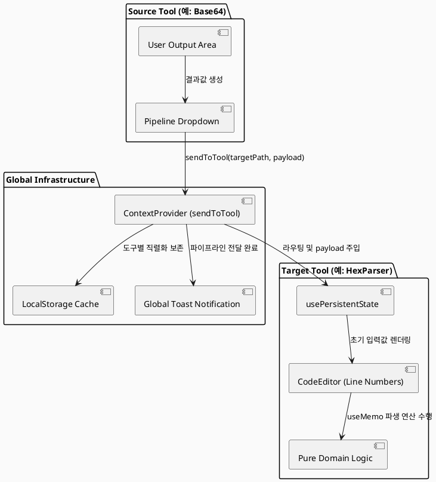

# DevTools: IoT·네트워크 엔지니어링 맞춤형 올인원 클라이언트 웹 유틸리티 플랫폼

본 연구 문서는 복잡한 통신 프로토콜, 패킷 덤프, 바이너리 비트 필드, 데이터 무결성 검증 및 암호화 키 관리를 웹 브라우저 환경에서 즉시 수행할 수 있도록 설계된 통합 개발자 유틸리티 **DevTools**의 전주기 엔지니어링 과정을 기술합니다. 본 프로젝트는 현업 IoT 및 네트워크 개발 실무에서 빈번히 마주하는 직무 특화형 요구사항을 수용하고, 외부 서버로의 데이터 유출 위험을 원천 차단하는 클라이언트 사이드 아키텍처를 기반으로 완성되었습니다.

- **실제 라이브 서비스 URL**: [https://aswinblue.github.io/DevTool](https://aswinblue.github.io/DevTool)
- **오픈소스 깃허브 저장소**: [https://github.com/AswinBlue/dev_tools](https://github.com/AswinBlue/dev_tools)

본고에서는 기획 및 사용자 인터랙션 분석과 기술적 소프트웨어 아키텍처 설계를 엄격히 분리하여, 소프트웨어 개발 생애주기(SDLC)에 입각한 체계적인 논문형 전개로 내용을 기술합니다. 특히 단순 프롬프트 입력에 의존하는 '바이브 코딩(Vibe Coding)'의 한계를 극복하고 대규모 시스템의 신뢰성을 담보하기 위해 적용된 **에이전트 하네싱(Agent Harnessing)** 거버넌스, **양방향 추적 사슬(Traceability Chain)**, 그리고 결함에 대한 **자가 치유(Self-Healing)** 사후 분석을 상세히 입증합니다.

---

## 1. [기획 및 제품 요구조건] 문제 정의와 요구조건 공학

소프트웨어 엔지니어링의 출발점은 현업 실무자가 직면한 비즈니스 및 개발 환경의 문제를 구체화하고, 이를 검증 가능한 요구조건 체계로 정립하는 작업입니다.

### 1.1. 비즈니스 문제 정의 및 3대 핵심 목표

임베디드 하드웨어, IoT 센서 노드 및 네트워크 라우터를 다루는 개발 환경에서는 시리얼 통신 프레임, 통신 헤더, 체크섬, 토큰 및 비트 마스크를 실시간으로 해석해야 하는 상황이 지속적으로 발생합니다. 그러나 기존 온라인 개발자 툴들은 다음과 같은 3대 구조적 한계를 가지고 있었습니다.

1. **사내 보안 정책 저촉 및 기밀 데이터 유출 위험**: 시중의 다수 웹 도구는 변환 연산을 백엔드 API 서버로 전송하여 처리하므로, 사내 비공개 통신 패킷, 개인키, 내부 API 인증 토큰을 입력할 경우 데이터 유출 사고로 이어질 수 있습니다.
2. **도구 파편화에 따른 극심한 컨텍스트 스위칭**: 패킷 바이트 파싱, CRC 체크섬 계산, Base64 디코딩, JSON 에러 진단 작업을 수행하기 위해 4~5개의 각기 다른 웹사이트를 오가며 복사·붙여넣기를 반복해야 하는 비효율이 존재합니다.
3. **IoT·네트워크 직무 특화 기능의 결여**: 일반 웹 개발자 중심의 도구 모음은 바이트 엔디안(Big/Little Endian) 해석, 비트 단위 필드 호버 매핑, 통신 표준 CRC 다항식 일괄 계산 등 하드웨어 및 통신 엔지니어가 필수적으로 요구하는 기능을 지원하지 못합니다.

DevTools는 이러한 기술적 갈증을 해소하고 엔지니어의 일일 생산성을 극대화하기 위해 다음의 **3대 핵심 설계 원칙**을 시스템 최상위 목표로 수립했습니다.

- **원칙 1: Zero-Leakage (100% 클라이언트 로컬 연산)**: 모든 바이트 파싱, 암호화, 해싱 및 포맷팅 연산은 브라우저의 자바스크립트 엔진과 Web Crypto API를 통해서만 수행되며, 어떠한 사용자 입력 데이터도 외부 네트워크로 전송되지 않습니다.
- **원칙 2: Zero-Latency Pipeline (도구 간 원클릭 데이터 파이프라인)**: 한 도구의 출력 결과(예: Base64 디코딩 데이터)를 클립보드를 거치지 않고 타 도구(HEX 파서, JSON 디버거 등)의 입력 상태로 원클릭 즉시 전달하여 작업 흐름의 단절을 제거합니다.
- **원칙 3: Zero-Installation (웹 표준 기반 즉각 접근)**: 무거운 네이티브 데스크톱 디버깅 프로그램을 설치하거나 환경을 설정할 필요 없이, 모던 웹 브라우저가 탑재된 모든 장비에서 URL 접속만으로 즉시 구동됩니다.

### 1.2. 스테이크홀더 요구조건의 단계별 구체화

상위 설계 목표를 바탕으로, 시스템을 활용하는 주요 엔지니어 군의 업무 시나리오를 분석하여 구체적인 요구조건 결정표를 수립했습니다.

| 스테이크홀더 | 핵심 업무 영역 | 구체화된 기능 명세 및 엔지니어링 경계 조건 |
|---|---|---|
| **IoT / 임베디드 엔지니어** | 패킷 분석 및 무결성 | Hex 문자열과 10진수, 2진수 비트 필드의 상호 동기화 뷰 제공, 마우스 호버 시 바이트·비트 오프셋 강조, 4-bit 비정렬 비트 마스크 및 Big/Little Endian 즉시 계산 |
| **통신 / 펌웨어 엔지니어** | 통신 프레임 검증 | CRC-8, CRC-16(MODBUS, CCITT, XMODEM), CRC-32 일괄 계산 및 하드웨어 통신용 커스텀 다항식·초기값·XOR 반전 지원 |
| **보안 / 네트워크 엔지니어** | 인증 및 키 관리 | 미지의 암호문·키 입력 시 JWT, X.509 PEM 인증서, JWK, 해시 포맷 스마트 자동 식별, 브라우저 내 Web Crypto 기반 AES 복호화 및 공개키 쌍 생성 |
| **일반 웹 / 백엔드 개발자** | 데이터 디버깅 및 포맷 | 문법 오류 라인/컬럼 가시화 및 콤마 자동 교정(Auto-Fix)을 갖춘 JSON 디버거, XML/YAML 상호 변환기, PlantUML 로컬 린터 및 GFM 마크다운 프리뷰 |

### 1.3. 사용자 인터랙션 흐름 및 기능군별 화면 전개

도출된 요구조건을 기반으로 총 14개 서브 시스템을 4대 핵심 도메인과 1개 통합 런처로 구조화하였으며, 실제 프로덕션 구동 화면과 상호작용 흐름은 다음과 같습니다.

#### 단계 A: 메인 허브 진입 및 런처 대시보드

사용자가 서비스에 진입하면 13개 세부 도구가 카테고리별로 정돈된 대시보드가 나타납니다. 모든 도구는 `Ctrl+K` 단축키를 통해 키보드만으로 즉시 검색하여 진입할 수 있으며, 다크 테마와 라이트 테마를 실시간으로 전환할 수 있습니다.

[](/IMAGE_DEV_TOOL_APP/screenshot_dashboard.png)

대시보드 상단에는 최근 작업 상태와 함께 각 기능군으로 원클릭 진입할 수 있는 퀵 런처 카드가 배치되어 있어 복잡한 메뉴 탐색 없이 직관적인 도구 선택이 가능합니다.

#### 단계 B: 바이너리 및 통신 데이터 분석군 (Data & Binary Inspection)

IoT 및 네트워크 현업에서 가장 빈번하게 발생하는 통신 프레임 해석을 위해 3개의 전문 검증 도구를 제공합니다.

1. **HEX & Bit 반응형 파서 (`/DevTool/HexParser`)**: 16진수, 10진수, 2진수 텍스트를 동시에 렌더링하며, 마우스 호버 시 바이트 인덱스와 비트(Bit 7..0)를 삼중 하이라이트합니다. 드래그 선택 시 Big-Endian과 Little-Endian 기준의 `Uint8~64`, `Int8~64`, `Float32/64`, 누적 체크섬(Sum/XOR)을 실시간으로 산출합니다.

[](/IMAGE_DEV_TOOL_APP/screenshot_hex_parser.png)

임베디드 시리얼 통신 로그나 네트워크 Wireshark 덤프를 붙여넣기만 하면, 복잡한 비트 연산 없이도 마우스 드래그만으로 패킷 페이로드의 정수 및 부동소수점 값을 즉각 확인할 수 있습니다.

2. **ASCII ↔ Hex 변환기 (`/DevTool/Ascii`)**: 문자열과 16진수 값을 양방향으로 변환하며, 단순 공백 구분 외에 C 언어 바이트 배열(`0x48, 0x65`), Python 바이트 리터럴(`b'\x48\x65'`), 2진수 비트열 출력을 지원합니다. 특히 개행(`LF`), 캐리지 리턴(`CR`), 탭(`TAB`) 등 비가시 제어문자를 시각적 배지로 명확히 표현합니다.

[](/IMAGE_DEV_TOOL_APP/screenshot_ascii_converter.png)

통신 프로토콜 디버깅 시 눈에 보이지 않아 혼선을 초래하는 제어문자의 존재 유무를 한눈에 파악할 수 있도록 배지 스타일링을 적용했습니다.

3. **CRC 계산기 (`/DevTool/Crc`)**: 임베디드 통신 프레임 무결성 검증을 위한 도구로, 입력 텍스트나 Hex 바이트에 대해 CRC-8, CRC-16(IBM, MODBUS, CCITT-FALSE, XMODEM), CRC-32, CRC-32C를 단일 화면에서 동시에 계산합니다.

[](/IMAGE_DEV_TOOL_APP/screenshot_crc_calculator.png)

산업용 표준 프로토콜뿐만 아니라 독자 규격의 펌웨어 프로토콜을 다루는 엔지니어를 위해 다항식(Polynomial), 초기값(Init), 반사(RefIn/RefOut), 최종 XOR 값을 커스텀으로 설정할 수 있는 파라미터 제어창을 완비했습니다.

#### 단계 C: 인코딩 및 웹 유틸리티군 (Encoding & Web)

네트워크 패킷 데이터와 웹 API 통신 데이터를 신속히 변환하고 시각화하는 3개의 웹 표준 도구를 제공합니다.

1. **Base64 다중 옵션 인코더/디코더 (`/DevTool/Base64`)**: 표준 Base64 외에 URL-Safe 치환(`-`, `_`), 패딩(`=`) 제거, MIME/PEM 표준 줄바꿈(64/76자) 포맷팅을 지원합니다. 또한 이미지 파일이나 바이너리 데이터를 Data URI(`data:image/png;base64,...`)로 상호 변환할 수 있습니다.

[](/IMAGE_DEV_TOOL_APP/screenshot_base64_converter.png)

디코딩 과정에서 손상된 Base64 문자열이 감지될 경우, 예외가 발생한 정확한 위치(1-based 문자 인덱스)를 사용자에게 즉시 안내하여 데이터 유실을 방지합니다.

2. **URL 파서 & Query Parameter 빌더 (`/DevTool/Url`)**: URL 문자열을 프로토콜, 호스트, 포트, 경로, 해시 단위로 분해하고, 쿼리 파라미터를 시각적인 키-값 테이블 형태로 편집할 수 있습니다.

[](/IMAGE_DEV_TOOL_APP/screenshot_url_builder.png)

테이블에서 파라미터 행을 추가, 수정, 삭제하는 즉시 상단의 전체 URL 문자열이 실시간으로 재조합되어 복잡한 API 호출 엔드포인트를 안전하게 구성할 수 있습니다.

3. **QR 코드 생성기 및 오프라인 파서 (`/DevTool/QrCode`)**: 와이파이 접속 정보, URL, 텍스트 데이터를 고해상도 PNG 및 벡터 SVG QR 코드로 즉시 생성할 수 있으며, 로컬 이미지 업로드 또는 클립보드(`Ctrl+V`) 캡처 붙여넣기를 통해 외부 서버 통신 없이 브라우저 내에서 QR 코드를 즉시 판독합니다.

[](/IMAGE_DEV_TOOL_APP/screenshot_qrcode.png)

IoT 기기의 현장 페어링이나 모바일 접속 테스트 시 별도의 스캐너 앱 없이도 브라우저 화면 안에서 양방향 QR 처리를 완결할 수 있습니다.

#### 단계 D: 보안·암호화 스위트 (Security & Cryptography)

인증 토큰, 전자서명, 대칭/비대칭 암호화 및 무작위 키 생성을 브라우저 네이티브 API로 완결하는 통합 보안 환경입니다.

[](/IMAGE_DEV_TOOL_APP/screenshot_security_suite.png)

1. **스마트 자동 판별 (Smart Auto-Inspect)**: 입력창에 문자열이 유입되면 JWT, X.509 PEM 인증서, PEM/JWK 키, Bcrypt, 해시 문자열 여부를 즉각 감지하여 규격, 알고리즘, 키 길이 및 만료일을 우측 상단 배지로 브리핑합니다.
2. **복호화 및 무결성 검증 (Decrypt & Verify)**: Web Crypto API를 호출하여 `HS256/384/512`, `RS256/384/512`, `ES256/384/512` 기반 JWT 서명 일치 여부를 판정하고, `AES-GCM/CBC/CTR` 암호문을 원문 평문으로 복호화합니다.
3. **암호화·서명·해싱 생성 (Encrypt & Sign)**: MD5, SHA-1, SHA-256, SHA-512, HMAC, PBKDF2, Bcrypt 해시를 생성하며, 난수 IV가 주입된 AES 대칭 암호문과 전자서명된 JWT 토큰을 발급합니다.
4. **암호화 키·시크릿 생성기 (Key Generator)**: RSA(2048~4096 bit), ECDSA(P-256/384/521), AES/HMAC 대칭키를 브라우저의 암호학적 난수 생성기를 통해 생성하여 PEM 및 JWK 포맷으로 추출합니다.

#### 단계 E: 포매터, 린터 및 시간 계산군 (Formatters, Viewers & Time)

데이터 구조화, 설정 파일 변환, 문서화 및 타임스탬프 계산을 담당하는 6개의 엔지니어링 도구입니다.

1. **JSON 디버거 & Auto-Fix (`/DevTool/Json`)**: 대용량 JSON 데이터의 구문 오류 위치(라인 및 컬럼)를 적색 포인터로 표시하며, 실무에서 빈번히 발생하는 후행 쉼표(Trailing Comma), 홑따옴표, 키 따옴표 누락을 `[오류 자동 교정]` 버튼 클릭 한 번으로 수복합니다.

[](/IMAGE_DEV_TOOL_APP/screenshot_json_debugger.png)

계층형 인터랙티브 트리 뷰를 통해 원하는 노드의 JSONPath(`$.store.book[0].title`)를 원클릭으로 추출할 수 있어 복잡한 API 응답 분석이 용이합니다.

2. **XML / YAML / JSON 상호 변환기 (`/DevTool/XmlYaml`)**: Kubernetes 매니페스트, CI/CD 설정, 시스템 설정 파일 간 포맷 변환을 지원하며, 파싱 에러 발생 시 정확한 에러 라인을 안내합니다.

[](/IMAGE_DEV_TOOL_APP/screenshot_xml_yaml.png)

3. **Text & JSON Semantic Diff (`/DevTool/Compare`)**: 단순 줄 단위(Line), 단어 단위(Word), 글자 단위(Char) 텍스트 비교뿐만 아니라, JSON 객체의 키 순서가 바뀌어도 의미론적 동일성을 판단하는 Semantic Diff 모드를 제공하며 `.diff` 패치 파일을 생성합니다.

[](/IMAGE_DEV_TOOL_APP/screenshot_diff_checker.png)

4. **Markdown GFM 라이브 뷰어 (`/DevTool/Markdown`)**: GitHub Flavored Markdown 문법을 실시간 렌더링하고 문서 내 헤더 목록을 목차(TOC)로 자동 추출하며, XSS 악성 스크립트를 살균한 정제 HTML 내보내기를 지원합니다.

[](/IMAGE_DEV_TOOL_APP/screenshot_markdown_viewer.png)

5. **PlantUML 로컬 린터/포매터 (`/DevTool/PlantUml`)**: 외부 렌더링 서버로 사내 아키텍처 다이어그램을 전송하지 않고, 브라우저 로컬 정적 분석 엔진을 통해 미종료 `@start*`/`@end*`, 블록(`alt`/`opt`/`group`↔`end`), 따옴표 불일치를 검출하고 안전한 자동 들여쓰기를 적용합니다.

[](/IMAGE_DEV_TOOL_APP/screenshot_plantuml_linter.png)

6. **UTC / Unix Epoch 타임 계산기 (`/DevTool/Time`)**: 실시간 타임스탬프 시계와 함께 10자리(초), 13자리(밀리초), 16자리(마이크로초), 19자리(나노초) 타임스탬프를 자동 식별하여 UTC, KST, EST 등 6대 표준 시간대로 변환하고 날짜 가감 연산을 제공합니다.

[](/IMAGE_DEV_TOOL_APP/screenshot_time_converter.png)

---



## 2. [에이전트 거버넌스] 100% 자율 에이전트 하네싱 프레임워크

사람이 직접 수천 라인의 소스코드를 작성하지 않고 AI 에이전트를 통해 프로덕션 수준의 안정성을 확보하기 위해서는, 단순 프롬프트 엔지니어링을 넘어선 체계적인 소프트웨어 거버넌스 프레임워크가 필수적입니다.

### 2.1. 바이브 코딩(Vibe Coding)의 붕괴 요인과 하네싱(Harnessing)의 필요성

최근 생성형 AI를 활용한 이른바 '바이브 코딩'이 주목받고 있으나, 시스템 규모가 일정 수준을 넘어서면 다음과 같은 치명적인 엔지니어링 붕괴 현상이 발생합니다.

- **컨텍스트 표류(Context Drift)**: 프로젝트가 확장됨에 따라 에이전트가 이전 단계에서 정의한 아키텍처 원칙, 네이밍 컨벤션, 의존성 제약을 망각하고 코드를 임의로 변조합니다.
- **추측성 방어 코드 및 미사용 모듈 누적**: 에이전트가 브라우저 런타임 환경을 확인하지 않고 불필요한 상용 라이브러리를 추가하거나, 실행 불가능한 죽은 분기(Dead Code)를 양산합니다.
- **회귀 버그의 연쇄 발생**: 한 도구의 로직을 수정하면서 다른 도구에서 공유하던 유틸리티 함수나 상태 인터페이스를 파괴하여 전체 빌드를 중단시킵니다.

DevTools 프로젝트는 이러한 붕괴를 사전에 차단하기 위해, 에이전트의 판단과 동작을 강제하는 **결정론적 가드레일(Guardrails)**과 **하네싱(Harnessing)** 체계를 구축하여 개발 전 과정을 통제했습니다.

### 2.2. 지침 계층 구조와 결정론적 도구화

본 프로젝트는 에이전트의 지침을 3단계 수직 계층 구조로 엄격히 분리하여 운영했습니다.

```
[최상위 지침: AGENTS.md] (무엇을 해야 하는가 - 프로젝트 철학 및 불변 원칙)
         │
         ▼
[규칙 계층: rules/*.md] (무엇을 준수해야 하는가 - 코딩 스타일, 보안, 테스트, 문서화 규격)
         │
         ▼
[실행 계층: skills/*.md] (어떻게 수행해야 하는가 - 재사용 가능한 워크플로우 실행 절차)
```

상위 계층은 목표(What)만을 정의하며 구체적인 구현 방법(How)은 하위 스킬로 위임됩니다. 또한 에이전트가 콘솔 명령어를 임의로 조합하여 오작동하는 것을 방지하기 위해, 테스트와 빌드 및 배포 작업을 표준화된 스크립트 도구(`scripts/run_test.ps1`, `scripts/build_deploy.ps1`, `scripts/test_build.ps1`)로 규격화하여 결정론적인 실행을 보장했습니다.

### 2.3. 파이프라인 라우팅 및 7단계 TDD 상태 머신

새로운 기능 개발이나 요구조건 변경 요청이 접수되면 에이전트는 코드를 즉시 작성하지 않고, 아래의 7단계 상태 전이 파이프라인을 엄격히 준수합니다.

```
요청 접수 (REQ) ──> 요구조건 명세 (PRD) ──> [Gate 1: 사용자 1차 컨펌]
                                                    │
                                                    ▼
테스트 선작성 (RED) <── 상세 설계 (SDS) <───────────┘
         │
         ▼
[Gate 2: 사용자 2차 컨펌] ──> 코드 구현 (GREEN) ──> 자동화 테스트 PASS ──> 보안/UI 감사
```

1. **요청사항 기록 (REQ)**: 요청 내용을 `req_{YYYY_MM}.md`에 시간 순서대로 기록합니다.
2. **요구조건 명세 (PRD)**: 7대 필수 명세 항목과 기능군 단위 Sequence Diagram(SQ), 검증 기준(VRF), 금지 제약(NC)을 명시합니다.
3. **[Gate 1: 1차 컨펌]**: 기획 및 시나리오에 대해 사용자의 승인을 받습니다.
4. **상세 설계 (SDS)**: 순수 함수 시그니처, PlantUML 상태 전이도(TR), 커버리지 매핑표를 작성합니다.
5. **테스트 선작성 (RED)**: 구현 전 실패하는 단위 테스트(`__tests__/*.test.js`)를 먼저 작성합니다.
6. **[Gate 2: 2차 컨펌]**: 설계 명세와 테스트케이스의 완전성을 확인받습니다.
7. **코드 구현 및 자가 치유 (GREEN)**: 테스트 러너를 실행하여 모든 테스트가 종료 코드 0으로 통과할 때까지 자가 치유 루프를 수행하고, 배포 전 보안 감사와 UI 검수를 완결합니다.

### 2.4. 양방향 추적 사슬 및 Graph MOC 지식 인덱스

프로젝트 내의 모든 엔지니어링 산출물은 고유 식별자 체계를 통해 빈틈없이 연결되어 100% 양방향 추적성을 확보했습니다.

- **요청사항 (`REQ26111501` ~ `REQ26111508`)**
- **요구조건 (`PRD26111501` ~ `PRD26111519`)**
- **상세설계 (`SDS26111501` ~ `SDS26111504`)**
- **테스트케이스 (`TST26111501` ~ `TST26111504`)**
- **결함 대장 (`ERR261115001` ~ `ERR261115004`)**

이 모든 추적 관계는 `agent_documents/Master_MOC.md` 내의 JSON Graph Database Index로 최신화되어, 특정 함수나 UI 컴포넌트를 수정할 때 영향을 받는 요구조건과 검증 테스트를 에이전트가 즉시 탐색할 수 있도록 지원합니다.

---

## 3. [기술적 구현] 시스템 아키텍처 및 상세 설계

DevTools의 기술적 엔지니어링은 서버 의존성을 완전히 배제하고 브라우저의 런타임 역량을 극한으로 활용하는 클라이언트 중심 아키텍처를 지향합니다.

### 3.1. 클라이언트 사이드 파이프라인 아키텍처

본 시스템은 React 18, React Router v6, Tailwind CSS를 기반으로 구축되었으며, 전체 데이터 흐름은 다음과 같은 단방향 파이프라인으로 구성됩니다.



- **도구 간 파이프라인 전달 메커니즘**: `ContextProvider`의 `sendToTool` 함수는 라우팅 이동과 함께 전역 메모리에 페이로드를 임시 적재합니다. 타겟 컴포넌트가 마운트될 때 커스텀 훅 `usePersistentState`가 해당 페이로드를 즉시 소비(Consume)하여 입력 에디터에 주입함으로써, 수동 복사-붙여넣기 없는 즉각적인 도구 간 체이닝을 구현했습니다.
- **비동기 상태 지속성(Persistence)**: 사용자가 각 도구에 입력한 데이터와 토글 옵션은 `devtools_state_{key}` 네임스페이스를 통해 브라우저 `localStorage`에 자동 동기화됩니다. 도구를 전환하거나 페이지를 새로고침하더라도 직전 작업 컨텍스트가 100% 복원됩니다.

### 3.2. 순수 도메인 로직 분리와 useMemo 기반 파생 상태 메모이제이션

컴포넌트 내부에 복잡한 비즈니스 계산 로직이 인라인으로 혼재될 경우 리렌더링 부하와 테스트 불가능성 문제가 발생합니다. DevTools는 UI 컴포넌트(`src/Pages/*.jsx`)와 순수 도메인 로직(`src/utils/*Logic.js`)을 엄격히 분리했습니다.

```
src/utils/
├── hexParserLogic.js    # HEX 파싱, 비트 오프셋 계산, 엔디안 자료형 변환, Sum/XOR 통계
├── crcLogic.js          # CRC-8/16/32 비트 반사, 다항식 테이블 생성 및 누적 계산
├── securityLogic.js     # JWT 구조 파싱, X.509 파싱, Web Crypto 암복호화/서명/키 생성
├── jsonDebugLogic.js    # 에러 라인/컬럼 진단 스니펫 추출, Trailing Comma Auto-Fix
└── plantUmlLogic.js     # 블록 짝 검사 로컬 린터 및 파싱 안전 2/4 Spaces 인덴터
```

모든 계산 함수는 순수 함수(Pure Function)로 구현되어 외부 환경이나 DOM에 의존하지 않으며, React 컴포넌트 내부에서는 **파생 상태(Derived State)** 방식을 채택했습니다.

```javascript
// 입력값과 옵션 변경 시에만 연산을 재수행하는 파생 상태 메모이제이션 패턴
const parsedResult = useMemo(() => {
    if (!hexInput.trim()) return null;
    try {
        const bytes = parseInputToBytes(hexInput, inputMode);
        return {
            bytes,
            stats: getGlobalStats(bytes),
            interpreted: interpretBitRange(bytes, selection.start, selection.end, endian)
        };
    } catch (err) {
        return { error: err.message };
    }
}, [hexInput, inputMode, selection, endian]);
```

별도의 `useEffect`와 세터 상태를 남발하지 않고 `useMemo`를 통해 입력의 변화에만 반응하여 결과를 계산하므로, 불필요한 리렌더링과 상태 불일치(State Tearing)를 원천 차단하여 뛰어난 반응성을 유지합니다.

### 3.3. 브라우저 네이티브 하드웨어 및 Web Crypto API 보안 파이프라인

외부 의존성 라이브러리의 보안 취약점과 번들 크기 증가를 억제하기 위해, 최신 웹 표준 네이티브 API를 적극적으로 활용했습니다.

1. **Web Crypto API (`window.crypto.subtle`)**: RSA, ECDSA 키페어 생성 및 JWT 서명 검증, AES-GCM 256비트 대칭 암복호화를 브라우저의 네이티브 C++ 가속 엔진으로 처리합니다.
2. **암호학적 난수 생성 (`window.crypto.getRandomValues`)**: 암호화에 필수적인 초기화 벡터(IV)와 솔트(Salt) 생성 시 예측 가능한 `Math.random()` 사용을 엄격히 금지하고, OS 엔트로피 풀을 활용하는 난수 API만을 사용하도록 강제했습니다.
3. **DOMPurify 기반 XSS 방어**: 마크다운 뷰어에서 HTML 렌더링 시 악성 스크립트 태그(`<script>`, `onerror=...`)를 철저히 정제(Sanitize)하여 임의 코드 실행 취약점을 무력화했습니다.

---



## 4. [실증적 검증 및 결함 진단] 자가 치유(Self-Healing) 포스트모템

소프트웨어 개발 과정에서 발생한 결함과 오류를 투명하게 기록하고 아키텍처 수준에서 영구 재발 방지책을 마련하는 것은 엔지니어링 신뢰성을 증명하는 핵심 과정입니다.

### 4.1. 결함별 3단 규격화 포스트모템

DevTools 개발 및 배포 과정에서 마주한 3대 주요 결함의 원인과 해결책은 다음과 같습니다.

#### [결함 1] GitHub Pages SPA 서브패스 라우팅과 로컬 프리뷰 흰 화면 충돌 (`ERR261115003`)

- **1) 결함 현상 (Phenomenon)**: 배포 전 사전 검증을 위해 `build_deploy.bat`의 로컬 프리뷰 서버(`serve -s build`)를 구동했을 때, 브라우저에 빈 흰 화면만 렌더링되며 개발자 도구 콘솔에 `Uncaught SyntaxError: Unexpected token '<'` 오류가 발생했습니다.
- **2) 아키텍처 근본 원인 (Root Cause Analysis)**: 프로젝트가 GitHub Pages의 서브 디렉터리(`https://aswinblue.github.io/DevTool/`)에 배포되도록 `package.json`의 `"homepage": "/DevTool"`로 설정되어 있었습니다. 그러나 범용 정적 서버(`serve`)는 루트(`/`) 경로 기준으로 정적 파일을 찾으려 시도했고, `/DevTool/static/js/...` 요청에 대해 번들 JS 파일 대신 최상위 `index.html`을 200 OK로 반환하여 스크립트 파싱 오류가 발생한 것입니다.
- **3) 자가 치유 영구 방어 조치 (Permanent Fix)**: 빌드 산출물 생성 시 서브패스를 복제 미러링하는 `scripts/prepare_preview.js`를 신설하고, `/DevTool` 서브패스 요청과 SPA 라우트 폴백을 완벽히 모사하는 전용 Node.js 프리뷰 서버(`scripts/preview_server.js`)를 구축하여 외부 서버 패키지 의존 없이 동일한 프리뷰 환경을 보장하도록 해결했습니다.

#### [결함 2] Private GitHub 서브모듈 의존성으로 인한 CI 빌드 실패와 모놀리식 통합 (`ERR261115004`)

- **1) 결함 현상 (Phenomenon)**: GitHub Actions에 등록된 자동 빌드 워크플로우(`web.yml`)가 소스코드 체크아웃 직후 `fatal: repository 'https://github.com/AswinBlue/ReactComponents/' not found` 에러를 뿜으며 즉시 중단되었습니다.
- **2) 아키텍처 근본 원인 (Root Cause Analysis)**: 공통 UI 요소를 담고 있던 `src/Components` 디렉터리가 Git 서브모듈(Submodule) 형태로 연결되어 있었는데, 해당 서브모듈 저장소가 비공개(Private) 상태로 설정되어 있어 GitHub Actions 러너의 기본 권한(`GITHUB_TOKEN`)으로는 서브모듈을 복제할 수 없었습니다.
- **3) 자가 치유 영구 방어 조치 (Permanent Fix)**: 외부 서브모듈 의존성을 프로젝트에서 완전히 격리 및 해제(`git rm --cached`, `.gitmodules` 삭제)하고, 프로젝트에서 실제로 사용하는 27개 컴포넌트 소스코드를 `src/Components/` 하위로 직접 복사하여 메인 저장소 내부로 영구 흡수 통합했습니다. 이를 통해 별도의 PAT(Personal Access Token) 발급 없이도 모든 CI/CD 파이프라인이 독립적으로 완결되도록 개선했습니다.

#### [결함 3] `js-yaml` default import 및 `BigInt` ESLint 전역 정의 빌드 컴파일 실패 (`ERR261115002`)

- **1) 결함 현상 (Phenomenon)**: XML/YAML 변환기 및 64비트 정수 연산 로직을 빌드하는 과정에서 Webpack이 `TypeError: yaml.dump is not a function`을 발생시키고, ESLint 검사에서 `no-undef: 'BigInt' is not defined` 경고가 빌드를 가로막았습니다.
- **2) 아키텍처 근본 원인 (Root Cause Analysis)**: `js-yaml` 라이브러리의 CommonJS/ESM 번들링 차이로 인해 기본 임포트(`import yaml from 'js-yaml'`)가 네임스페이스 객체를 올바르게 바인딩하지 못했으며, 구형 브라우저 타깃 ESLint 환경에서 ES2020의 `BigInt` 생성자를 인식하지 못했습니다.
- **3) 자가 치유 영구 방어 조치 (Permanent Fix)**: 임포트 방식을 `import * as yaml from 'js-yaml'` 네임스페이스 전체 임포트로 정규화하고, 바이너리 로직 파일 최상단에 `/* global BigInt */` 선언을 명시하여 브라우저 엔진 간 호환성을 유지하면서 빌드를 100% 정상화했습니다.

### 4.2. [품질 감사] 사용자 대면 카피 및 오픈소스 라이선스 고지

프로덕션 출시 직전 수행된 소프트웨어 품질 감사에서는 기술적 결함뿐만 아니라 법적 리스크와 사용자 경험을 정밀 점검했습니다.

- **상용 라이브러리 완전 제거**: 과거 실험적으로 포함되었던 상용 라이브러리(Syncfusion 등)의 미사용 잔재 코드를 전수 조사하여 완전히 제거함으로써 잠재적 저작권 리스크를 원천 소멸시켰습니다.
- **오픈소스 라이선스 고지 의무 이행**: 프로젝트에서 사용된 12개 핵심 오픈소스 패키지(`diff`, `marked`, `DOMPurify`, `node-forge`, `js-yaml`, `fast-xml-parser`, `qrcode`, `jsqr`, `bcryptjs`, `crypto-js` 등)의 저작권 및 라이선스 고지문을 집대성한 `OPEN_SOURCE_LICENSES.md`를 발행하고, 웹 UI 하단 푸터에서 언제든 열람할 수 있는 `OpenSourceLicenseModal.jsx` 팝업을 탑재했습니다.

---

## 5. 결론 및 향후 로드맵

### 5.1. 소프트웨어 공학 관점에서의 핵심 기여점

DevTools 프로젝트는 특화된 도메인 요구조건을 가진 IoT·네트워크 엔지니어링 실무를 위해 탄생한 클라이언트 사이드 도구 모음입니다.

1. **보안과 프라이버시의 완벽한 보장**: 민감한 통신 패킷과 암호키를 외부로 한 바이트도 유출하지 않는 100% 브라우저 로컬 연산 아키텍처를 실현했습니다.
2. **도구 간 연속성을 보장하는 워크스페이스 UX**: 원클릭 파이프라인 데이터 전달과 `localStorage` 기반 상태 보존을 통해 개발자의 일상적인 컨텍스트 스위칭 비용을 획기적으로 절감했습니다.
3. **AI 에이전트 하네싱의 실증적 성공 모델**: 7단계 TDD 파이프라인, 엄격한 계층 지침, 양방향 추적 사슬을 통해 인간 개발자의 직접적인 코드 타이핑 없이도 상용 소프트웨어 수준의 높은 품질을 자율 구축할 수 있음을 증명했습니다.

### 5.2. 향후 확장 로드맵

현재 구축된 1.2.0 버전을 기반으로, 향후 다음과 같은 고도화 작업을 추진할 계획입니다.

- **WebAssembly(Wasm) 기반 대용량 패킷 덤프 디코더**: 대용량 Wireshark PCAP/PCAPNG 캡처 파일을 브라우저 메모리에 고속 로드하여 패킷별 레이어 트리를 파싱하는 Rust-Wasm 엔진 통합.
- **PWA(Progressive Web App) 완전 오프라인 캐싱**: 서비스 워커(ServiceWorker)를 도입하여 네트워크가 완전히 차단된 폐쇄망 연구소나 산업 현장에서도 설치형 데스크톱 앱처럼 100% 오프라인 구동 지원.
- **국제화(i18n) 다국어 지원**: 글로벌 엔지니어 커뮤니티의 접근성을 제고하기 위한 영어 및 다국어 언어팩 지원 체계 구축.
