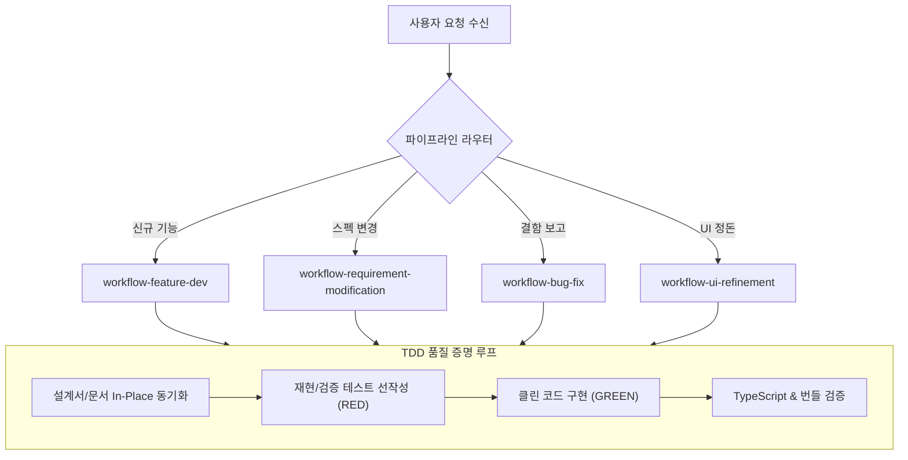
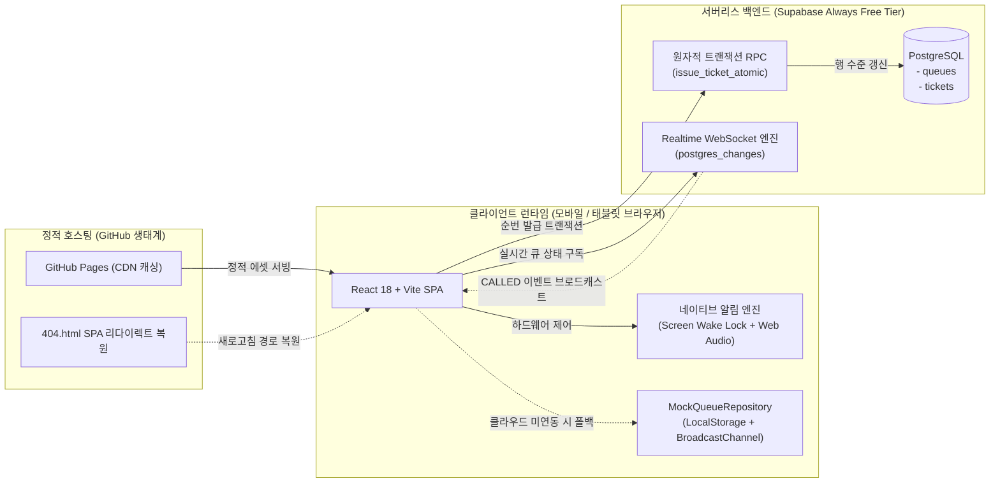

# JullSir(줄서): 100% 자율 AI 에이전트 주도 무비용 실시간 대기열 시스템 엔지니어링

본 연구 문서는 별도의 전용 태블릿 하드웨어나 월정액 클라우드 인프라 비용 없이 모바일 웹 브라우저 환경에서 즉시 동작하는 실시간 대기열 관리 솔루션인 **JullSir(줄서)**의 전주기 개발 과정을 기술합니다. 본 프로젝트는 초기 비즈니스 문제 정의부터 요구조건 구체화, 아키텍처 설계, 구현, 결함 진단 및 배포에 이르는 모든 단계를 **100% 자율 AI 에이전트 파이프라인(Autonomous Agent Pipeline)**으로 수행하여 완성되었습니다.

- **실제 라이브 서비스 URL**: [https://aswinblue.github.io/JullSir](https://aswinblue.github.io/JullSir)
- **오픈소스 깃허브 저장소**: [https://github.com/AswinBlue/JullSir](https://github.com/AswinBlue/JullSir)

본고에서는 비기술적 기획 분석과 기술적 엔지니어링 설계를 엄격히 분리하여, 소프트웨어 개발 생애주기(SDLC)에 입각한 체계적인 논문형 전개로 내용을 기술합니다. 특히 단순 프롬프트 입력에 의존하는 '바이브 코딩(Vibe Coding)'의 한계를 극복하고 대규모 시스템을 통제하기 위해 도입한 **에이전트 하네싱(Agent Harnessing)** 거버넌스, **양방향 추적 사슬(Traceability Chain)**, 그리고 **자가 치유(Self-Healing)** 메커니즘을 상세히 입증합니다.

---

## 1. [기획 및 제품 요구조건] 문제 정의와 요구조건 공학

소프트웨어 개발의 첫 단계는 시장과 사용자가 직면한 비즈니스 문제를 정의하고, 이를 추상적인 아이디어에서 검증 가능한 소프트웨어 요구조건으로 단계별 구체화하는 작업입니다.

### 1.1. 비즈니스 문제 정의 및 3대 핵심 목표

현장 대기열이 발생하는 소규모 요식업, 팝업스토어, 행사 부스 등에서는 대기 고객 관리가 필수적이지만, 기존 상용 큐잉 솔루션은 소상공인과 독립 운영자에게 감당하기 어려운 3대 진입 장벽을 안겨줍니다.

1. **초기 하드웨어 도입 비용**: 전용 태블릿 키오스크 및 거치대 구매 비용 (기기당 수십만 원 소요).
2. **고정 SaaS 구독료**: 매월 수만~수십만 원에 달하는 플랫폼 월정액 과금.
3. **건당 통신 비용**: 고객 호출 시 발생하는 카카오 알림톡 및 LMS 문자 발송 단가 (트래픽에 비례하여 누적).

JullSir는 이러한 비용 구조를 파괴하고 누구나 스마트폰 하나로 현장 대기열을 즉시 운영할 수 있도록 다음의 **3대 핵심 설계 원칙**을 시스템 최상위 목표로 수립했습니다.

- **원칙 1: Zero-Cost (월 운영 예산 $0 유지)**: 정적 호스팅(GitHub Pages)과 무료 클라우드 티어(Supabase Free Tier)를 조합하여 상시 비용 0원을 달성한다.
- **원칙 2: Zero-PII (개인식별정보 수집 제로)**: 전화번호, 이름, 이메일 등 개인정보를 전혀 수집하지 않고 순수한 난수 식별자(UUID)와 인원수로만 대기열을 운영하여 법적 보안 책임을 원천 차단한다.
- **원칙 3: Zero-Domain (독립 유료 도메인 배제)**: 유료 도메인 구입이나 복잡한 DNS(SPF/DKIM/DMARC) 인증을 요구하지 않고, 웹 표준 네이티브 API로 호출을 전달한다.

### 1.2. 스테이크홀더 요구조건의 단계별 구체화

상위 비즈니스 목표를 바탕으로, 현장에서 시스템과 상호작용하는 두 가지 핵심 사용자 군(Host 점주, Guest 고객)의 관점에서 요구조건을 구체화했습니다.

| 스테이크홀더 | 요구조건 영역 | 구체화된 기능 명세 및 경계 조건 |
|---|---|---|
| **Host (매장 관리자)** | 큐 생성 및 설정 | 별도 가입 절차 없이 매장명, 고객 안내문, 예상 대기 시간을 입력하여 10초 만에 대기열 개설 (기본 세션 6시간) |
| **Host (매장 관리자)** | 현장 화면 격리 | 태블릿 거치용 디스플레이(`/display/:queueId`)를 제공하되, 뒤로가기나 주소창 조작으로 관리자 제어 권한에 접근할 수 없도록 토큰 기반 격리 |
| **Host (매장 관리자)** | 비순차 순번 제어 | 4인 테이블 공석 발생 시 2인 대기자를 건너뛰고 4인 대기자를 즉시 호출할 수 있는 비순차 호출(Call Specific) 및 스킵(Skip) 지원 |
| **Guest (방문 고객)** | 무설치 즉시 발권 | 전용 앱 다운로드나 로그인 없이 모바일 카메라로 매장 QR 코드를 스캔하여 1초 만에 익명 대기표 발급 |
| **Guest (방문 고객)** | 실시간 상태 시각화 | 내 순번, 현재 호출 번호, 내 앞 남은 팀 수, 예상 대기 시간을 0.05초 단위로 실시간 동기화하여 확인 |
| **Guest (방문 고객)** | 가상 진동벨 피벗 | SMS/알림톡 대신 화면 꺼짐 방지(Screen Wake Lock)와 브라우저 내장 합성 차임벨/진동으로 차례 도래를 즉각 인지 |

### 1.3. 사용자 인터랙션 흐름 및 화면 전개

도출된 요구조건을 기반으로 설계된 3단계 서비스 인터랙션 흐름과 실제 프로덕션 구동 화면은 다음과 같습니다.

#### 단계 A: 메인 허브 진입 및 대기열 개설 흐름
서비스 진입 시 점주와 고객의 역할이 카드 형태로 명확히 분리되며, 점주는 회원가입 없이 즉시 대기열을 생성합니다.


대기열 생성 화면에서는 매장 특성에 맞춘 안내 문구(호출 후 유예 시간 등)와 예상 대기 시간을 지정하며, 데이터베이스 부하를 방지하기 위한 6시간 자동 세션 파기 정책이 안내됩니다.


#### 단계 B: 매장 현장 거치 및 손님 모바일 발권 흐름
점주가 매장 태블릿에 거치해두는 공용 화면은 고대비 다크 테마로 렌더링되며, 직관적인 대형 QR 코드와 대기 인원 수를 원거리에서도 쉽게 식별할 수 있도록 구성했습니다.


고객이 카메라로 QR 코드를 스캔하면 모바일 전용 발권 화면이 즉시 열리며, 방문 인원 수(Party Size) 프리셋 버튼을 터치하여 원클릭으로 번호표를 수령합니다.


#### 단계 C: 실시간 대기, 관리자 제어 및 호출 상호작용 흐름
발권 후 손님 화면에는 내 순번과 함께 화면 자동 잠금을 방지하는 Screen Wake Lock 상태가 활성화되며, 자발적 권한 획득을 유도하는 `[소리 테스트]` 버튼이 제공됩니다.


점주 관리자 화면에서는 대기 목록을 실시간으로 감시하며 다음 번호 호출, 개별 행 순번 스킵, 비순차 호출을 유연하게 제어할 수 있습니다.


점주가 호출을 트리거하면 손님 기기 화면 전체가 에메랄드 네온 테마로 반전되며, 화면 중앙의 콘페티 효과와 함께 가상 진동벨 비프음 루프가 1분간 지속됩니다.


---



## 2. [에이전트 거버넌스] 100% 자율 에이전트 하네싱 프레임워크

사람의 직접적인 코드 타이핑 없이 전체 소프트웨어를 완성하기 위해서는 단순 대화형 프롬프트를 넘어선 구조화된 엔지니어링 거버넌스가 요구됩니다.

### 2.1. 바이브 코딩(Vibe Coding)의 붕괴 요인과 하네싱(Harnessing)의 필요성

자율 AI 에이전트에게 복잡한 풀스택 애플리케이션의 개발을 맡길 때 발생하는 주요 실패 패턴은 세 가지로 수렴합니다.

1. **컨텍스트 오염 및 목표 망각 (Context Drift)**: 대화가 길어짐에 따라 에이전트가 초기 비즈니스 제약(예: Zero-Cost 원칙)을 잊고 유료 라이브러리나 외부 서버를 도입하려 함.
2. **동작 중인 코드의 파괴적 재작성 (Regression)**: 새로운 기능을 구현하는 과정에서 기존에 완벽히 동작하던 상태 머신이나 예외 처리 로직을 임의로 덮어써 망가뜨림.
3. **가짜 성공 단언 (Phantom Success)**: 코드가 빌드되지 않거나 런타임 오류가 발생함에도 스스로 문제가 해결되었다고 판단하고 작업을 조기 종료함.

이러한 한계를 해결하기 위해 본 프로젝트에서는 에이전트에게 무제한의 창의성을 허용하지 않고, 행동의 경계선(Guardrails)과 검증 루프를 엄격히 강제하는 **에이전트 하네싱(Agent Harnessing)** 아키텍처를 구축했습니다.

### 2.2. 지침 계층 구조(Hierarchy)와 결정론적 도구화

에이전트가 의사결정을 내릴 때 참조하는 지침서를 단일 프롬프트에 몰아넣지 않고, 추상도에 따라 4단계로 계층화했습니다.

```
[Layer 0] agents.md       : 최상위 엔지니어링 철학, 코딩 불변 원칙, 인코딩 표준 (What to achieve)
   ↓
[Layer 1] rules/workflow/ : 업무 유형별(기능 개발, 결함 수정 등) 오케스트레이션 절차 규정
   ↓
[Layer 2] rules/          : 금지 제약, UI 방어 규격, 테스트 정책, 문서화 제약
   ↓
[Layer 3] skills/         : 도구 조작, 스크립트 실행, diff 생성, 포스트모템 작성 (How to execute)
```

상위 계층에서는 목적(What) 위주로 기술하고 하위 계층에만 구체적인 방법(How)을 위임함으로써, 에이전트가 매 작업마다 불필요한 토큰을 소모하지 않고 필요한 스킬 문서만 선별적으로 로드(Lazy Evaluation)하도록 유도했습니다.

또한, 에이전트가 터미널에서 임의의 셸 명령어를 조합하다 비대화형 대기 상태에 빠지는 문제를 차단하기 위해 결정론적 진입점인 **스크립트 하네스(Script Harness)**를 구축했습니다.

```powershell
# 에이전트의 터미널 명령어 실행 표준화
.\scripts\dev.ps1        # 로컬 격리 개발 서버 기동
.\scripts\test.ps1       # Vitest 자동화 단위 테스트 스위트 구동
.\scripts\build-prod.ps1  # TypeScript 컴파일 검증 및 프로덕션 번들링
```

### 2.3. 파이프라인 라우팅 및 TDD 상태 머신

사용자 요청이 인입되었을 때 에이전트가 곧바로 코드를 수정하는 것은 전면 차단되었습니다. 모든 입력은 파이프라인 라우터에 의해 전용 오케스트레이터 스킬로 전달되었습니다.



- **코드 선행 작성 엄격 금지**: 모든 기능 수정은 설계 문서(PRD/SDS)의 In-Place 동기화와 실패하는 테스트케이스(RED) 선작성을 거친 후에만 코드 구현이 허용되었습니다.
- **자가 치유 빌드 루프**: 코드 변경 후 반드시 `pnpm typecheck`와 빌드 번들링을 자동 실행하여, 오류 발생 시 종료 코드 0이 될 때까지 스스로 원인을 분석하고 패치를 반복하는 Self-Healing을 강제했습니다.

### 2.4. 양방향 추적 사슬(Traceability Chain) 및 Graph MOC 지식 인덱스

프로젝트의 규모가 확장될 때 컨텍스트 붕괴를 막는 핵심 장치는 **고유 식별자 기반의 양방향 추적 사슬**입니다.

```
요청사항 (REQ)  ──►  기획명세 (PRD)  ──►  상세설계 (SDS)
      ▲                                       │
      │                                       ▼
 결함대장 (ERR)  ◄──  실제코드 (Code)  ◄──  자동검증 (TST)
```

1. **식별자 명명 표준**:
   - `REQ{YYMMDDNN}`: 비즈니스 요구사항 이력 (Append-Only 불변 보존)
   - `PRD{YYMMDDNN}`: 7대 필수 명세 항목을 갖춘 제품 기획 사양
   - `SDS{YYMMDDNN}`: 컴포넌트, 상태 천이, 데이터 모델 상세 설계
   - `TST{YYMMDDNN}`: 자동화 테스트케이스 코드 및 단언문
   - `ERR{YYMMDDNNN}`: 결함 포스트모템 및 자가 치유 이력 대장
2. **Graph Database JSON 인덱스 (`agent_documents/Master_MOC.md`)**:
   에이전트가 수십 개의 마크다운 파일을 일일이 읽지 않도록 노드(Node), 엣지(Edge), 키워드(Keyword)로 구조화된 JSON 색인을 유지하여, 변경 요청 발생 시 영향 범위를 1초 내에 확정하도록 지원했습니다.

---

## 3. [기술적 구현] 무비용 실시간 아키텍처 및 시스템 상세 설계

JullSir의 기술 아키텍처는 서버 유지비 0원을 달성하면서도 상용 큐잉 솔루션 이상의 실시간성과 안정성을 보장하도록 정밀하게 설계되었습니다.

### 3.1. 무비용(Zero-Cost) 분산 시스템 아키텍처

호스팅, 데이터베이스, 실시간 이벤트 브로드캐스트의 3대 레이어를 완전 무비용 계층으로 일체화했습니다.



- **정적 배포와 SPA 라우팅**: GitHub Pages 환경에서 서브패스(`/JullSir/`)를 기준으로 SPA가 동작할 때 발생하는 새로고침 404 문제를 해결하기 위해, `public/404.html`에서 쿼리스트링으로 경로를 변환하고 `index.html`에서 즉시 복원하는 SPA Redirect Restore 패턴을 적용했습니다.
- **아키텍처 비교 우위**: Vercel 풀스택(Next.js) 모델 대비, 순수 정적 번들 서빙 방식은 서버리스 함수 실행 시간(Cold Start)이 전혀 없고 CDN 엣지 캐싱 효율이 극대화되어 초저지연 로딩을 보장합니다.

### 3.2. 원자적 동시성 제어 및 실시간 데이터 파이프라인

수많은 손님이 동시에 QR 코드를 스캔하여 번호표를 뽑을 때 가장 치명적인 결함은 동일한 번호가 복수 발급되는 레이스 컨디션(Race Condition)입니다.

JullSir는 PostgreSQL의 단일 트랜잭션 격리 수준을 활용하는 원자적 RPC 함수를 작성하여 이 문제를 해결했습니다.

```sql
-- 동시 발권 번호 중복을 완벽히 차단하는 원자적 RPC
CREATE OR REPLACE FUNCTION issue_ticket_atomic(
    p_queue_id UUID,
    p_party_size INTEGER DEFAULT 1,
    p_subscription JSONB DEFAULT '{}'::jsonb
)
RETURNS JSONB
LANGUAGE plpgsql
AS $$
DECLARE
    v_next_number INTEGER;
    v_ticket_id UUID;
    v_now TIMESTAMP WITH TIME ZONE := NOW();
BEGIN
    -- 1. 대기열 행에 배타적 락(Row-Level Exclusive Lock)을 걸어 순번 원자적 증가
    UPDATE queues
    SET last_issued_number = last_issued_number + 1,
        last_active_at = v_now
    WHERE id = p_queue_id
    RETURNING last_issued_number INTO v_next_number;

    -- 2. 티켓 테이블에 안전하게 신규 레코드 삽입
    INSERT INTO tickets (queue_id, ticket_number, party_size, status, push_subscription, created_at)
    VALUES (p_queue_id, v_next_number, p_party_size, 'WAITING', p_subscription, v_now)
    RETURNING id INTO v_ticket_id;

    RETURN jsonb_build_object(
        'id', v_ticket_id,
        'ticket_number', v_next_number,
        'status', 'WAITING'
    );
END;
$$;
```

클라이언트는 Supabase Realtime 채널을 통해 `tickets` 테이블의 변경 사항을 실시간 청취(`postgres_changes`)하며, 점주가 순번을 호출하는 즉시 0.05초 이내에 손님 브라우저로 이벤트가 전파됩니다.

### 3.3. 브라우저 네이티브 하드웨어 제어 파이프라인

외부 푸시 서버나 SMS 인프라를 일체 사용하지 않기 위해 최신 웹 표준 하드웨어 제어 API를 결합했습니다.

- **Screen Wake Lock API**: 손님이 대기표를 켜둔 상태에서 화면이 꺼지거나 단말이 절전 모드로 진입하여 WebSocket 연결이 단절되는 것을 방지하기 위해 `navigator.wakeLock.request('screen')`을 상시 유지합니다.
- **Web Audio API 합성 차임벨 엔진**: 외부 MP3 음원 파일 다운로드에 의존하지 않고, 브라우저 오디오 컨텍스트의 오실레이터(OscillatorNode)를 활용해 523.25Hz(C5)와 659.25Hz(E5) 주파수를 실시간 합성하여 맑은 2음 차임벨을 생성합니다.
- **Vibration API**: 모바일 환경에서 호출 시 `[500ms 진동 - 250ms 정지 - 500ms 진동]` 패턴을 60초간 반복 순환시켜 물리적 진동벨과 완벽히 동일한 체감을 제공합니다.

---



## 4. [실증적 검증 및 결함 진단] 자가 치유(Self-Healing) 포스트모템

100% 에이전트 주도로 개발을 진행하는 과정에서 실제 브라우저 보안 정책 및 레이아웃 제약으로 인해 발생했던 고난도 결함과, 이를 진단하고 영구 패치한 자가 치유(Self-Healing) 사례를 공유합니다.

### 4.1. [결함 1] 브라우저 Autoplay Policy와 비동기 오디오 스레드 동기화 (ERR261101001)

#### 1) 결함 현상 (Phenomenon)
고객이 모바일 브라우저에 대기표 화면을 켜두고 대기하던 중, 점주가 관리자 화면에서 호출 버튼을 눌렀을 때 화면 텍스트는 정상적으로 갱신되었으나 차임벨 소리가 전혀 나지 않는 현상이 발생했습니다. 고객이 화면의 빈 공간을 터치하면 그제서야 적체되어 있던 차임벨 소리가 뒤늦게 울렸습니다.

#### 2) 아키텍처 근본 원인 (Root Cause Analysis)
Chromium 및 WebKit 엔진은 웹페이지 로드 후 사용자의 명시적인 클릭 제스처가 발생하지 않은 상태에서 소리가 자동 재생되는 것을 차단하는 **Autoplay Policy**를 엄격히 적용합니다.
점주의 호출은 원격 WebSocket 이벤트 스택에서 수신되므로, 이 시점의 브라우저 실행 스택에는 사용자 제스처(User Activation Token)가 부재합니다. 따라서 `audioCtx.resume()` 호출이 브라우저 정책에 의해 조용히 거부(Silent Rejection)되어 오디오 노드가 유휴 큐에 적체되었던 것입니다.

#### 3) 자가 치유 영구 방어 조치 (Permanent Fix)
에이전트는 3중 방어 메커니즘을 설계하여 이 문제를 근본적으로 해결했습니다:

```typescript
// 1. 발권 시점(명시적 User Gesture)에 AudioContext 언락 및 무음 루프 유지
public unlockAudio(): void {
  const ctx = this.getAudioContext();
  if (ctx.state === 'suspended') {
    ctx.resume();
  }
  // 유휴 정지를 원천 차단하는 무음 버퍼 노드 바인딩
  this.startKeepAliveBuffer(ctx);
}

// 2. 사후 알람 끄기 클릭 시 잔여 사운드 방출 차단
public stopBuzzerLoop(): void {
  if (this.masterGainNode) {
    // 게인을 0으로 즉시 소거하여 큐잉된 오실레이터 소리 방출 방어
    this.masterGainNode.gain.setValueAtTime(0, this.audioContext.currentTime);
  }
}
```

또한 직접 링크나 QR 코드로 진입하여 발권 제스처를 거치지 않은 고객을 위해 대기 화면 상단에 명시적인 `[🔊 소리 테스트]` 버튼을 배치하여 자발적인 터치 제스처를 유도했습니다.

### 4.2. [결함 2] 분산 데이터 계층 간 스키마 불일치와 비파괴 메타데이터 영속화 (ERR261101002)

#### 1) 결함 현상 (Phenomenon)
고객이 발권 화면에서 '6명'을 선택하고 번호표를 뽑았으나, 발권 완료 화면과 관리자 대시보드 모두에서 방문 인원 수가 `(1명)`으로 고정되어 표시되는 결함이 발생했습니다.

#### 2) 아키텍처 근본 원인 (Root Cause Analysis)
프론트엔드 레포지토리 레이어는 `partySize` 값을 정상적으로 전달받았으나, Supabase 원자적 순번 발급 RPC인 `issue_ticket_atomic` 호출 파라미터에서 해당 값을 전달하지 않았습니다. 데이터베이스 테이블에 별도의 `party_size` 컬럼이 사전에 생성되어 있지 않아 엔티티 역직렬화(`mapDbTicket`) 단계에서 기본값 1로 폴백되었습니다.

#### 3) 자가 치유 영구 방어 조치 (Permanent Fix)
운영 중인 서비스의 무중단 패치를 위해 기존 테이블의 `push_subscription` JSONB 컬럼을 활용하여 `{ party_size: partySize }` 메타데이터를 즉각 보존하도록 1차 패치했습니다. 이후 정식 SQL 마이그레이션 스크립트를 생성하여 `party_size` 물리 컬럼을 DDL에 추가하고 RPC 인자를 표준화했습니다.

### 4.3. [결함 3] 고정폭 뷰포트 내 레이아웃 오버플로우와 방어적 CSS 규격화 (ERR261101003)

#### 1) 결함 현상 (Phenomenon)
모바일 기기 화면에 맞추어 `max-w-md`(448px)로 고정된 카드 UI 내부에서 점주용 관리 액션 버튼들이 카드의 우측 경계선을 뚫고 돌출되는 레이아웃 깨짐 현상이 보고되었습니다.

#### 2) 아키텍처 근본 원인 (Root Cause Analysis)
카드 컨테이너는 448px 고정폭인데, 자식 요소에서 반응형 그리드 유틸리티인 `sm:grid-cols-3`를 선언하여 화면 폭 640px 이상의 태블릿/PC 환경에서 3개 컬럼으로 강제 분할되었습니다. 이로 인해 각 컬럼의 너비가 110px 미만으로 축소되었고, `whitespace-nowrap` 속성을 가진 '현재 번호 스킵' 버튼(150px 이상 소요)이 컨테이너를 이탈했습니다.

#### 3) 자가 치유 영구 방어 조치 (Permanent Fix)
가로 분할 그리드를 전면 폐기하고 풀위드 수직 스택(`flex-col gap-3 w-full`)으로 재구성하여 버튼 간 안전 터치 마진을 확보했습니다. 에이전트는 이를 향후 유사 결함을 원천 방어하기 위해 `rules/quality/ui-quality.md`에 **가변 텍스트 5대 방어 수칙**으로 영구 편입했습니다.

1. 고정폭 모바일 뷰포트 내부에서 부모 컨테이너 크기와 무관한 뷰포트 미디어 쿼리(`sm:`, `md:`) 단독 사용 금지.
2. 모든 가변 텍스트 요소에 `min-w-0`, `truncate` 또는 `break-keep` 병용 의무화.
3. 터치 버튼은 최소 높이 44px 및 `w-full` 수직 배치를 우선 적용.

### 4.4. [품질 감사] 사용자 대면 카피 감사(Copy Audit): 개발자 기술 용어의 정제 (REQ26110104)

에이전트가 초기 작성한 UI에는 내부 아키텍처 명세가 그대로 노출되는 문제가 있었습니다.

- *수정 전 UI*: "0-Cost / Zero-PII 실시간 아키텍처 기반의 익명 발권 시스템입니다."
- *수정 후 UI*: "전화번호 입력 없이 바로 번호표를 뽑으세요."

에이전트는 전용 `user-facing-copy-audit` 스킬을 자체 실행하여, 개발자 중심의 인프라 단어('0-Cost', 'Serverless', 'RPC', 'Token')를 전수 탐색하고 고객과 점주 관점의 직관적인 가치 제안(Value Proposition) 문구로 전면 교체했습니다.

---

## 5. 결론 및 AI 주도 엔지니어링의 시사점

JullSir 프로젝트는 사람이 직접 소스코드를 한 줄도 작성하지 않고, 오직 **'에이전트에게 어떤 엔지니어링 환경, 제약, 검증 하네스를 부여할 것인가'**를 설계함으로써 고품질의 실서비스용 웹 애플리케이션을 완성할 수 있음을 실증한 연구 사례입니다.

### 5.1. 소프트웨어 공학 관점에서의 핵심 기여점

1. **바이브 코딩에서 규율 기반(Discipline-driven) 개발로의 패러다임 전환**:
   단순 프롬프트에 의존하는 개발은 시스템 복잡도가 증가할 때 필연적으로 붕괴합니다. 에이전트 개발의 성패는 엄격한 **금지 제약(Negative Constraints)**, **문서 계층화**, 그리고 **양방향 추적 사슬**의 유무에 달려 있습니다.
2. **결정론적 스크립트 도구화의 중요성**:
   에이전트에게 임의의 셸 권한을 개방하기보다, 사전에 정돈된 빌드/테스트 스크립트(`scripts/test.ps1`, `build-prod.ps1`)를 도구 인터페이스로 제공하는 것이 환각과 명령 오류를 원천 차단하는 핵심입니다.
3. **완전 자동 자가 치유(Self-Healing)의 실효성 증명**:
   테스트 실패 시 종료 코드 0이 될 때까지 원인 분석과 패치를 반복하는 TDD 상태 머신을 구축함으로써, 브라우저 오디오 보안 정책이나 레이아웃 충돌과 같은 고난도 결함도 사람의 개입 없이 자율적으로 해결될 수 있음을 입증했습니다.

### 5.2. 향후 확장 로드맵

현재 JullSir는 GitHub Pages와 Supabase Free Tier 환경에서 성공적으로 서비스되고 있으며, 향후 다음과 같은 고도화가 예정되어 있습니다.

- **Offline-First PWA 큐잉 엔진**: 네트워크 순시 단절 시에도 기기 로컬 저장소와 가상 진동벨이 중단 없이 동작하고 재연결 시 동기화되는 오프라인 내결함성 확보.
- **다국어(i18n) 1:1 대칭 사전**: 글로벌 관광 상권을 위한 한국어/영어/일본어/중국어 런타임 언어 전환 지원.
- **GitHub Actions Keep-Alive 헬스체크 연동**: Supabase Free Tier의 7일 비활성 인스턴스 일시 정지(Pause)를 원천 방어하기 위한 정기 자동 핑(Ping) 워크플로 통합.

JullSir 프로젝트의 전체 소스코드와 아키텍처 문서, 에이전트 지침 체계는 [GitHub 저장소](https://github.com/AswinBlue/JullSir)에서 열람할 수 있습니다.
